# FluidEQ · User guide

> Find your sound. Make yourself at home.

A practical guide to FluidEQ, with illustrations drawn by the app’s own controls. Start with your first listening session, then explore at your own pace.

Every picture is drawn by FluidEQ's own interface, in English and its default colours; in the app the same figures follow your language and window colours. Example settings illustrate the controls; they are not recommended presets.

**In FluidEQ: Help → User guide, or press F1.**

[Open the illustrated, print-ready edition](user-guide.html)

**Get started**

1. [Your first five minutes](#start)
2. [Around the window](#window)
3. [The Compact player](#player)
4. [What your PC needs](#requirements)
5. [The FluidEQ Engine](#engine)

**Shape your sound**

6. [Shape your sound with EQ](#eq)
7. [EQ mode and band designs](#eqmode)
8. [Gaming Lab](#games)
9. [The Game filter: steps, surroundings and voices](#gamefilter)
10. [Headphone correction & imports](#headphones)
11. [My curves: import, edit and share](#mycurves)
12. [Use an impulse response](#convolution)
13. [Devices, profiles & second output](#profiles)
14. [Auto EQ: each song’s sound](#songs)
15. [Inspect & back up a chain](#config)
16. [Explore the DSP rack](#dsp)
17. [Normalizer and live level control](#normalizer)
18. [Denoise & source analysis](#denoise)
19. [De-esser: soften sharp voices](#deesser)
20. [Dynamics: quiet and loud passages](#dynamics)
21. [The Room: surround on headphones](#room)
22. [Crossfade and custom fade curves](#crossfade)
23. [Your microphone’s sound](#mic)

**See your music**

24. [The graph and its controls](#graph)
25. [Styles and scenes](#looks)

**Scenes and your account**

26. [Your account, credits and the Scenes tab](#plus)
27. [The Scenes gallery](#gallery)
28. [Make scenes in the Studio](#studio)
29. [The desktop background](#desktop)
30. [Dynamic lighting (beta)](#lighting)

**Listen, sing and share**

31. [Listen with Online Media](#online)
32. [Browse and tidy your Library](#library)
33. [Records, Up next and lyrics](#queue)
34. [Sing with Karaoke](#karaoke)
35. [Create in Karaoke Maker](#maker)
36. [Share audio between computers](#share)

**When you need help**

37. [When something sounds wrong](#trouble)
38. [Ask in the Forum](#forum)

## Your first five minutes

Start with a familiar song at a comfortable volume. The left rail holds FluidEQ’s power key and the preamp; the centre is your workspace, with the graph over your bands; the sound panel on the right follows your output and its profiles. The bar at the foot of the window controls whatever is playing. The tour below streams only when you press Play. For the gaming page, see Gaming Lab.

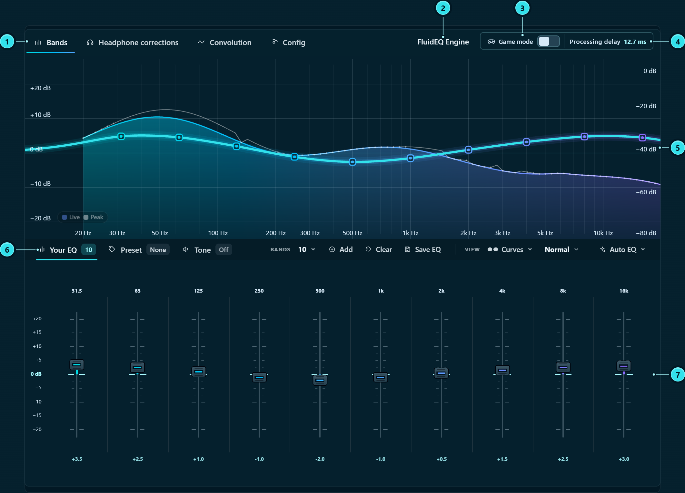

1. **The EQ’s pages** — Bands, Headphone corrections, Convolution and Config: what shapes the sound, one page each.
2. **The engine** — Which engine plays your EQ: the FluidEQ Engine or Equalizer APO. A red dot means it is not reaching the output you are listening to.
3. **Game mode** — Cuts the delay FluidEQ adds, for games and calls. Gaming presets turn it on.
4. **Processing delay** — How late the engine plays the sound on this output. Press it to see which stage adds what.
5. **The graph** — Your EQ’s curve and a point on every band, with what you hear moving behind it. Drag a point to shape the sound; the graph chapter has the rest.
6. **Your EQ, Preset, Tone** — Three tabs under the graph: your own bands, a ready-made preset under them, and the Tone’s cuts and dials. Each tab’s tools stand at the row’s end.
7. **Your bands** — One slider per band, its frequency on top and its gain below. The EQ chapter shows each part.

### Try it

1. Install FluidEQ and keep the FluidEQ Engine selected when setup asks how to process your sound. Windows asks for permission once, with no restart.
2. Choose your listening device in the sound panel’s Output card. Press the power key at the top of the left rail and leave Auto normalize on.
3. Play a song, open EQ → Bands, drag one band’s slider a little, and compare with the power key off and on.

> **Good to know:** System-wide EQ needs Windows and an audio engine: the FluidEQ Engine or Equalizer APO. On macOS and Linux the app shows demonstration outputs, so a moving graph there is not proof that anything is processed.

## Around the window

The header takes you between FluidEQ’s pages and shows the sound as it plays. The left rail holds FluidEQ’s power key, the preamp and the level meter; the sound panel on the right follows your output and its profiles.

### The header, up to the signal

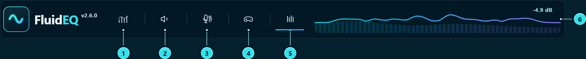

1. **Scenes** — Scenes: the gallery, the Studio and Dynamic lighting.
2. **Share Audio** — Sends this computer’s sound to another one, or plays another one’s here.
3. **Mic** — Your microphones, each with a voice sound of its own that every app hears.
4. **Gaming Lab** — Your games, each with a sound of its own, tuned for that game.
5. **EQ** — Your bands, presets, headphone correction and the engine’s config.
6. **Audio signal** — What is playing, as it plays, with its peak level; the graph’s View menu can hide it.

### The header, after the signal

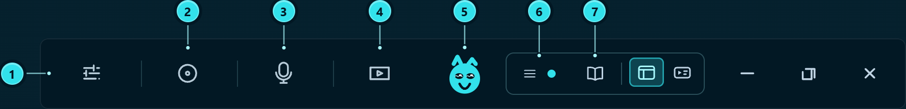

1. **DSP** — The effects rack: presets, the Room and every stage of the chain.
2. **Library** — Your music files, albums and play queue.
3. **Karaoke** — Sing along, and make karaoke out of your own songs.
4. **Online Media** — YouTube, YouTube Music, Bandcamp, Twitch and Suno, played inside FluidEQ with your EQ on them.
5. **Support the work** — Ways to support the work on FluidEQ.
6. **FluidEQ actions** — Two columns. Commands and behaviour: the engine, Fix audio problems, Restart Windows audio, the On/off key (a shortcut that turns all FluidEQ processing off and on while another app is in front; none at first, and a card above your other windows confirms each switch), importing EQ settings or an impulse response, Processes, Reset all settings, animations, Start with Windows and the language. Looks: Brightness, Tint and its second colour, Tint app icon, the EQ sliders and Set as desktop background.
7. **Help** — This guide, What’s new, Full release notes, Forum, the audio troubleshooter, Report a problem and About FluidEQ. Full release notes opens all the notes directly. About has links to its sections and, where the support link is available, a Buy Me a Coffee card with a QR code.

### The left rail

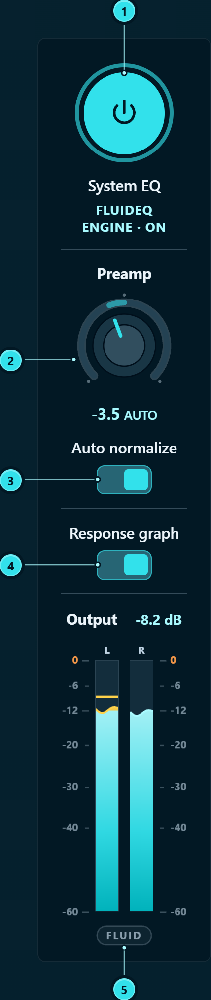

1. **System EQ** — FluidEQ’s power key: turns its processing on or off for everything the PC plays. The line under it names the engine; it turns red when the engine is not reaching the output you are listening to, and a press then asks about the engine.
2. **Preamp** — Lowers the level before the EQ so boosts have room. While Auto normalize holds it, it reads AUTO; with it off, turn the dial or press its number to type a level. Ctrl+click returns it to 0 dB.
3. **Auto normalize** — Keeps the preamp just low enough that nothing you boost can clip.
4. **Response graph** — Shows or hides the response graph.
5. **Level meter** — The output level, left and right, in real decibels, with the louder channel’s peak above it. Press it for its next style; Ctrl+press goes back one.

### Try it

1. Open a page from the header: Scenes, Share Audio, Mic, Gaming Lab, EQ, DSP, Library, Karaoke, Online Media.
2. Press the power key at the top of the left rail to turn FluidEQ on, and leave Auto normalize on, so no boost can clip.
3. Press the level meter for its next style; Ctrl+press goes back one.
4. In the ≡ menu, slide Brightness anywhere from fully dark to fully white, and give Tint a second colour to draw the bands, the title and the lit controls in a gradient between the two.
5. To switch processing from another app, open the ≡ menu → On/off key and choose your own key combination. No key is assigned at first; the confirmation above other windows says whether FluidEQ is on or off.
6. Right-click any text field for Cut, Copy, Paste and Select all. Searches ignore case, accents, spaces and punctuation: typing kpop matches K-pop.

> **Good to know:** Help opens this guide, What’s new, the audio troubleshooter and Report a problem. The ≡ menu beside it has two columns. On the left: the engine card, Fix audio problems, Restart Windows audio, the On/off key, importing EQ settings or an impulse response, Processes, which shows what each part of FluidEQ is using, Reset all settings, animations, Start with Windows (FluidEQ then starts in the tray, shaping your sound with no window open) and the language. On the right, the window’s looks: Brightness, Tint (its two swatches are the window’s colour and a second one for a gradient), Tint app icon (off at first; it puts the taskbar, tray and tray-menu icons in the window’s colours), the EQ sliders and Set as desktop background. Notices stack at the bottom right of the window. The switch after the menus turns the window into the Compact player.

## The Compact player

One switch turns FluidEQ’s window into the Compact player, a single narrow column: a scene or style at the top with the song over it and the play controls under it, then Sound, your equaliser, then Up next and your playlists. Whatever is playing keeps playing, and the same switch brings the full app back on the page you left.

### The top: the song, and how it plays

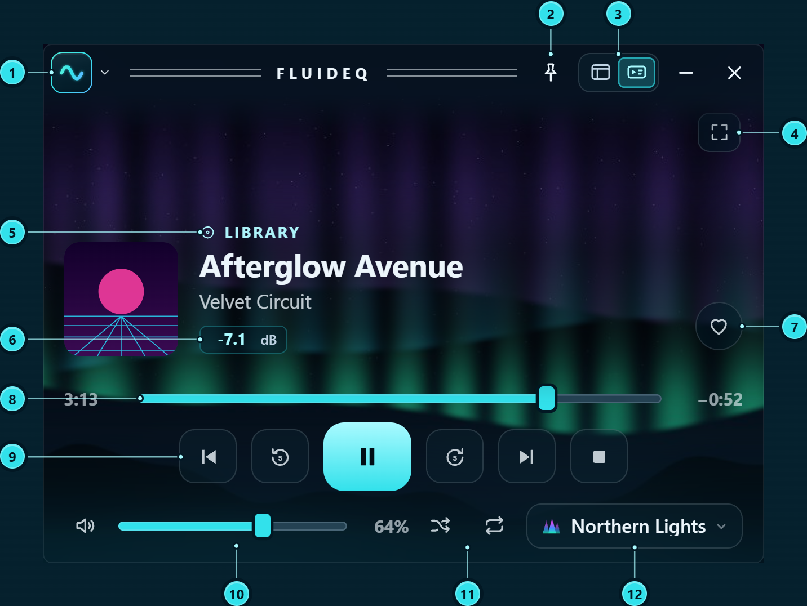

1. **Player menu** — Back to the full app or to one of its pages; the player’s own Brightness, Transparency or Tint, a scene’s Daylight, Tint app icon and the EQ sliders; Always on top and Fold to one line.
2. **Always on top** — Keeps the player above every other window.
3. **Compact player** — Back to the full app, on the page you left.
4. **Full screen** — Fills the screen with the scene or style. Double-clicking the picture does the same, and Escape gives the screen back.
5. **Source** — Where the song is coming from: the Library, Online Media, Karaoke, another computer or another program on this PC. Pressing it opens that page in the full app.
6. **Output level** — The level of the sound leaving FluidEQ, in decibels.
7. **Add to Favourites** — Adds a song from the Library to your Favourites, or takes it out.
8. **Position in the song** — Where the song is. Drag to jump.
9. **Play controls** — Previous, back five seconds, play or pause, forward five seconds, next and stop.
10. **System volume** — Your computer’s volume, the same as in Windows: it sets the level of everything the computer plays.
11. **Shuffle and repeat** — Shuffles Up Next, and repeats nothing, everything or this song.
12. **Look** — The style or scene on the player. Press it to choose from all of them.

### Sound, your equaliser

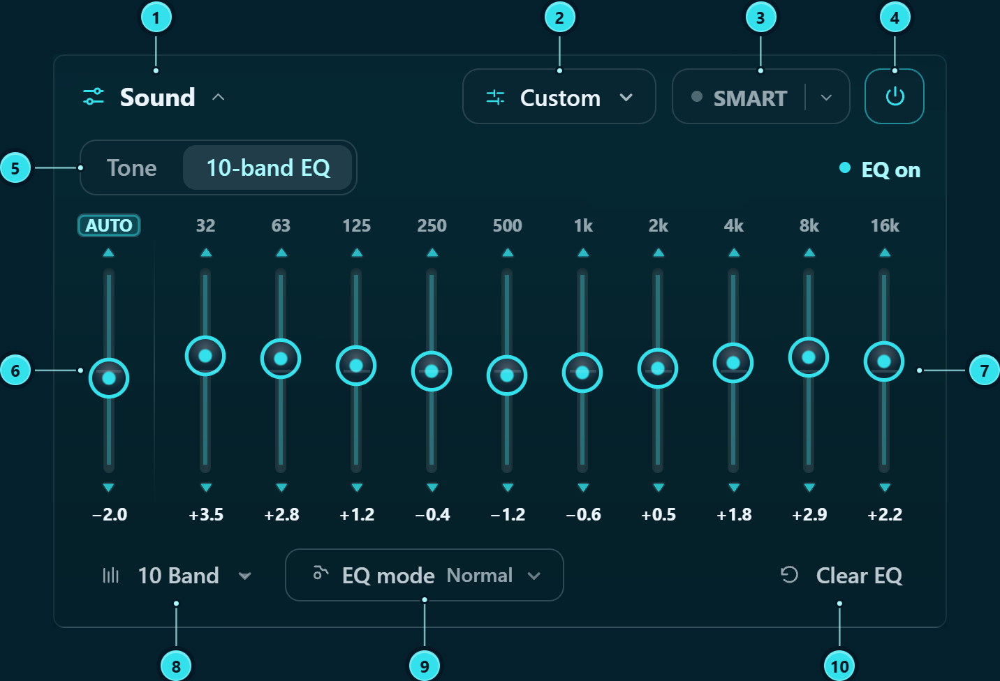

1. **Sound** — Folds the sound controls down to this row, which keeps the preset, Smart correction and the switch at hand, and opens them again.
2. **Presets** — A ready-made chain for the sound, such as Music or a genre. None leaves only your own bands.
3. **Smart correction** — Auto EQ: each song’s saved sound, its album’s sound from the Library, and Smart correction on top — Detail, Balance or Target.
4. **System EQ** — FluidEQ’s power key: turns its processing on or off for everything the PC plays. The line under it names the engine; it turns red when the engine is not reaching the output you are listening to, and a press then asks about the engine.
5. **Tone** — Tone shows the Bass, Mid and Treble dials; the tab beside it, every band.
6. **Preamp** — Lowers the level before the EQ so boosts have room. While Auto normalize holds it, it reads AUTO; with it off, turn the dial or press its number to type a level. Ctrl+click returns it to 0 dB.
7. **Bands** — Drag a band up or down to boost or cut it. Its frequency is written under it.
8. **Quick layouts** — How many bands: band counts that start every band at one Q, the band designs you saved, and Reset layout.
9. **EQ mode** — Opens EQ mode: how strongly your EQ and the curves apply, their band Q, phase and treble.
10. **Clear EQ** — Sets every gain, and the Tone, to 0 dB and keeps your bands. Asks first.

### Up next

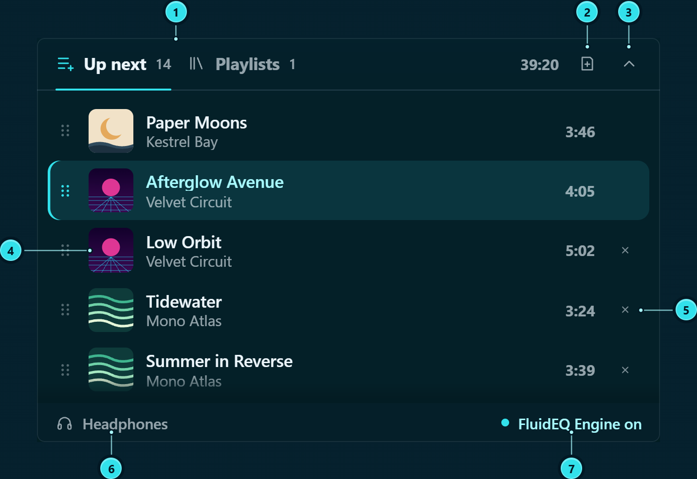

1. **Up next** — Up next and Playlists, each with how many it holds, and the time left in the queue.
2. **Save as playlist** — Keeps Up next as a playlist of its own.
3. **Fold the queue** — Folds Up next and Playlists down to their tabs, and the picture takes the room.
4. **The songs** — What plays next. Click a song to play it, drag it to move it, or drop music files here to add them where you let go.
5. **Remove from the queue** — Takes a song that has not played yet out of Up next.
6. **Output** — Where the sound is going: the output Windows plays through.
7. **Engine** — Which engine is shaping the sound, lit while FluidEQ is on.

### The player’s menu

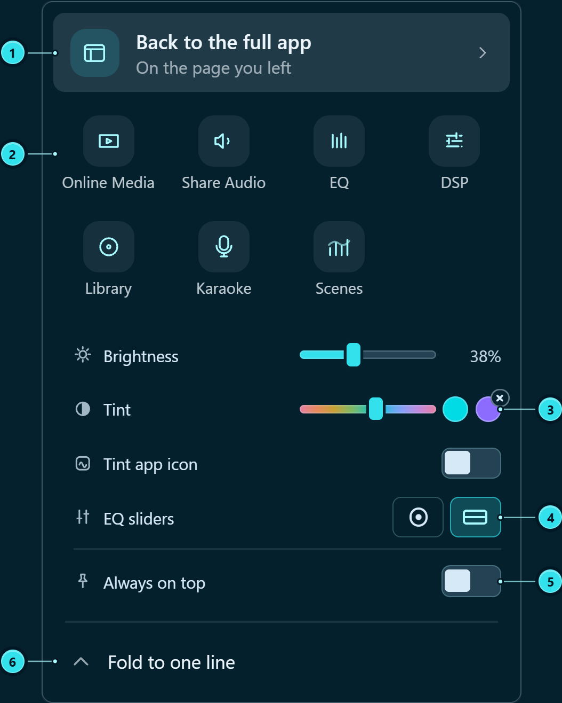

1. **Back to the full app** — Back to the full app, on the page you left.
2. **Open in the full app** — Opens the full app on one of its pages.
3. **Brightness** — The player’s own Brightness, apart from the full app’s; Transparency over a scene, or the window’s Tint over a standard style; a scene’s Daylight; and Tint app icon, off at first, for the taskbar icon, the tray icon and the icon in the tray’s menu in the window’s colours.
4. **EQ sliders** — Round handles or rectangular caps on the EQ’s sliders, here and on the EQ page.
5. **Always on top** — Keeps the player above every other window.
6. **Fold to one line** — Folds the player to one line.

### Folded to one line

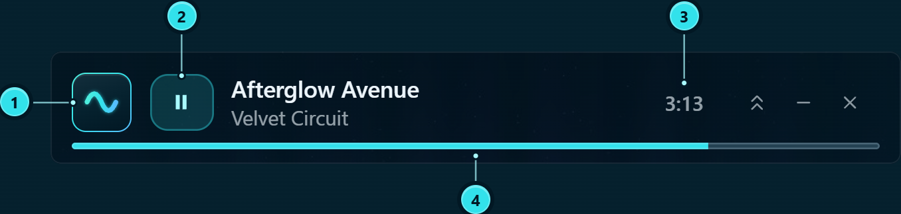

1. **Unfold** — Unfolds the player. The arrow at the other end does too.
2. **Play** — Play or pause.
3. **Time played or time left** — Time played. Click it for the time left.
4. **Position in the song** — Where the song is. Drag to jump.

### Try it

1. Press the Compact player switch in the title bar, beside Help. On the player, the same switch brings the full app back.
2. Fold Sound, or Up next and Playlists, down to its header, and the picture takes the room; press the header to open it again. Drag the player’s top or bottom edge to make it taller or shorter.
3. Double-click the picture to fill the screen with it; Escape gives it back. Press the look’s name beside shuffle and repeat to choose from every style and scene.
4. Choose Fold to one line in the FluidEQ mark’s menu to fold the player down to one line; the mark unfolds it.
5. In the same menu, set the player’s own Brightness, the Transparency over a scene or the window’s Tint over a standard style, and a scene’s Daylight. Always on top, there or in the header, keeps it above other windows.
6. Drop music files anywhere on the player: they join the Library and the end of Up next or, over the list, the place where you let go.
7. In Sound, choose Tone for Bass, Mid and Treble or Bands for the full EQ. Its preset and EQ mode controls change the same output as the full app. Explore scenes opens the gallery in the full window; automatic scene switching works in the Compact player too.

> **Good to know:** The player’s volume is your computer’s own, the same as in Windows, so it sets the level of everything the computer plays. If the player ends up off the screen, right-click FluidEQ in the taskbar’s tray and choose Recover the window. While a game’s sound is on, the game button shows just the game’s name so it fits the Compact player.

## What your PC needs

FluidEQ runs on any Windows PC of the last ten years. Two parts ask for more than the rest: the scenes draw on the graphics card, and the karaoke AI downloads its models the first time you use it.

### Try it

1. Check your Windows: Windows 10 version 1803 or later, or Windows 11, 64-bit, 4 GB of memory and about 600 MB of disk. Processing everything the PC plays needs the FluidEQ Engine or Equalizer APO, and Windows asks for permission once while it installs.
2. Play scenes: any graphics card or built-in graphics from 2013 onwards. At 1080p built-in graphics are enough; 4K, or a desktop background on several screens at once, is happier with a dedicated card. On a busy card FluidEQ draws the scene smaller and lets go of the ones you cannot see.
3. Try the karaoke AI: separating a voice downloads a 713 MB model the first time, the pitch model adds about 360 MB, and noise removal 11 MB. With a DirectX 12 graphics card a four-minute song separates in around half a minute; on the processor alone it takes about four minutes. Keep 2 GB of memory free while it works.
4. Aim for this if you can: Windows 11, 8 GB of memory, graphics from 2018 onwards, and 3 GB of disk free if you use the AI features.

> **Good to know:** Everything but the AI models is in the installer, and those download only when you first use the feature. Processes, in the actions menu, shows what each part of FluidEQ is using on your machine right now.

## The FluidEQ Engine

FluidEQ processes your sound with its own engine or with Equalizer APO. The FluidEQ Engine runs inside Windows' audio service after your sound card's effects, brings your EQ and the DSP rack to everything the PC plays, and steps aside the moment FluidEQ closes.

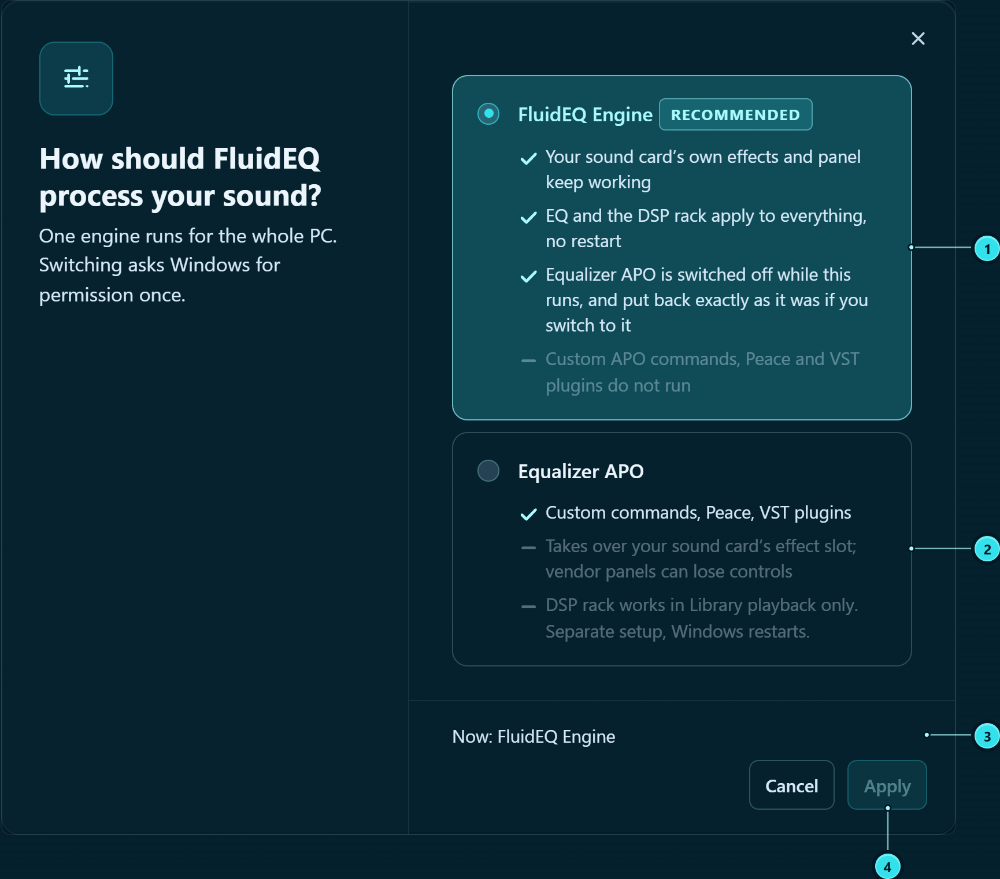

1. **FluidEQ Engine** — Recommended. Your sound card's effects keep working, and the EQ and DSP rack reach every app.
2. **Equalizer APO** — Runs custom APO commands, Peace and VST plugins. The DSP rack stays with Library playback.
3. **The engine now** — Which engine plays your sound now; Apply stays off until you choose the other.
4. **Apply** — Switches the engine. Windows asks once, and audio restarts for a few seconds.

### Try it

1. Open the actions menu (≡) and press the engine card at the top.
2. Choose FluidEQ Engine and press Apply. Windows asks for permission, and audio pauses for a few seconds while it restarts.
3. If an output shows OFF, press Enable on its notice. If a notice says the engine is not running, press Restart Windows audio.

> **Good to know:** Equalizer APO remains available for custom APO commands, Peace and VST plugins. When an update brings a newer engine, a notice offers Update engine. Quitting FluidEQ from the tray turns the EQ off on every output.

## Shape your sound with EQ

Your EQ is the bands you shape yourself. Frequency chooses where a band acts, Gain sets the boost or cut, and Q sets its width: higher Q is narrower. Under the graph three tabs share the page: Your EQ, Preset and Tone, each a layer of its own. Begin with small, broad changes and compare often.

### The tabs under the graph, on Your EQ

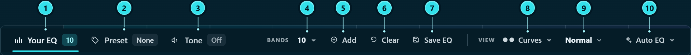

1. **Your EQ** — Your own bands, and how many there are.
2. **Preset** — The preset under your bands, and the presets to pick from: by genre, by use, and your own.
3. **Tone** — Low cut, High cut, Bass, Mid and Treble: quick tone that leaves your bands as they are. It says Off while none is in use.
4. **Quick layouts** — How many bands: band counts that start every band at one Q, the band designs you saved, and Reset layout.
5. **Add EQ band** — Adds a band beside the selected one, at the Q of the bands already there.
6. **Clear EQ** — Sets every gain, and the Tone, to 0 dB and keeps your bands. Asks first.
7. **Save EQ** — Keeps what plays as a saved EQ, updates the one that is on, puts another on, or opens them all to manage.
8. **Curves** — What else shapes this output — a preset, a headphone correction, Smart correction, a convolution — each with its strength, its switch and ×.
9. **EQ mode** — How strongly your EQ and the curves apply, band Q, phase, treble and smoothing; it says Normal until you change something. With the EQ mode card pinned, it brings the card into view.
10. **Auto EQ** — Auto EQ: each song’s saved sound, its album’s sound from the Library, and Smart correction on top — Detail, Balance or Target.

### Your bands

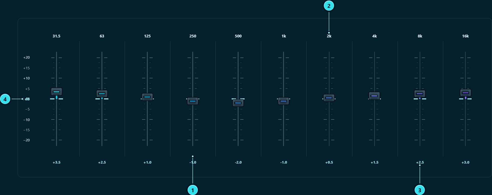

1. **A band** — Drag its slider to boost or cut, or step it with the arrow keys. Ctrl+scroll over it changes its Q.
2. **Frequency** — Click it to select the band. Ctrl+click or double-click puts it back on the layout’s frequency.
3. **Gain** — The band’s gain, in dB.
4. **dB scale** — From +20 to −20 dB beside the sliders, with 0 dB marked, as a console prints it beside its faders.

### A band’s popover, while Shift is held

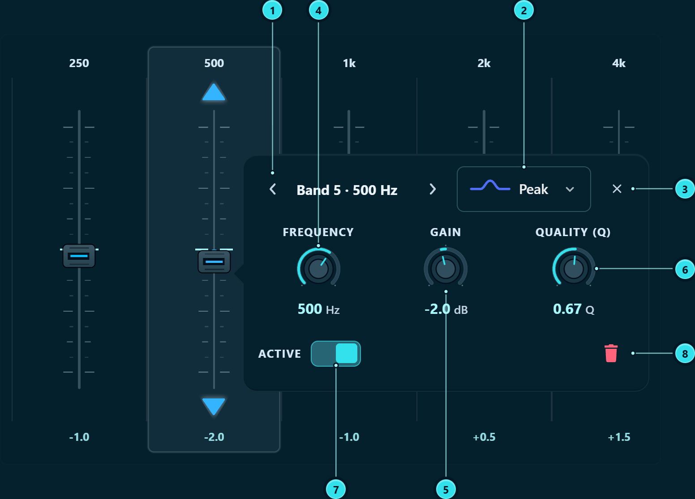

1. **Band before and after** (`Shift+Tab`) — ‹ and › move the popover to the band below or above, as Shift+Tab and Tab do inside it.
2. **Filter** — Its shape: a peak, a shelf, a notch or a pass filter.
3. **Close the band settings** (`Esc`) — Puts the popover away and keeps the band selected. Letting go of Shift does the same.
4. **Frequency** — Where the band acts, from 1 Hz to 20 kHz.
5. **Gain** — How much it boosts or cuts. Ctrl+click returns it to 0 dB.
6. **Quality (Q)** — How wide it is: higher is narrower. Ctrl+click returns it to the layout’s Q.
7. **Active** — Takes the band out of the sound and keeps its settings.
8. **Delete band** — Press once to arm it, again to delete the band; the × beside it changes your mind.

### A band's right-click menu

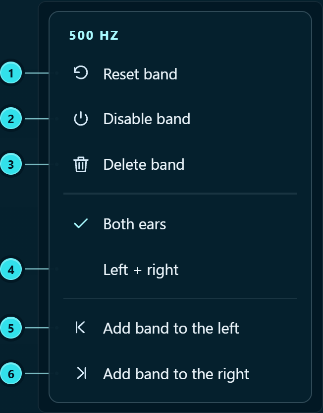

1. **Reset band** — Gain back to 0 dB and Q back to 2.
2. **Disable band** — Takes the band out of the sound and keeps its settings.
3. **Delete band** — Turns red and asks for a second press before it deletes the band.
4. **Left + right** — One band for each ear at the same frequency, to move apart; Both ears joins them again.
5. **Add band to the left** — Adds a band halfway to its lower neighbour.
6. **Add band to the right** — Adds a band halfway to its higher neighbour.

### Try it

1. Open EQ → Bands. Your EQ holds your bands; Preset puts a ready-made sound under them, and New preset makes one of your own; Tone has Low cut, High cut, Bass, Mid and Treble, drawn as a line of their own.
2. Drag a band’s slider, or its point on the graph, to boost or cut; the curve follows as you move. Click a band’s frequency, or its point, to select it. Ctrl+scroll over a band changes its Q.
3. Hold Shift with a band selected to bring up its popover beside it: its filter, the Frequency, Gain and Q dials, Active and the bin. Shift+Tab and Shift+← → step to the band before or after; Esc or × puts it away.
4. Everything works from the keyboard too: Tab to a slider, a dial or a point on the graph, and the arrow keys step it; Page Up and Page Down take bigger steps.
5. Right-click a band to reset it, switch it off, delete it (it asks for a second press), add a band beside it, or choose Left + right: one band for each ear at the same frequency, the left ear’s curve drawn solid and the right’s dashed. Both ears joins the two again.
6. Select several bands with Ctrl or Shift, or drag a box round them, to move them together; Ctrl+A on the graph selects every band.
7. Save EQ keeps what plays as a saved EQ you can put on again, update or manage. Clear sets every gain to 0 dB and keeps your bands; it asks first.
8. A preset of your own (Preset → New preset) starts its curve from a preset or flat; you shape it on the graph and its rack on the DSP page. Its tile’s menu exports it to a file, and Import on the Preset tab reads one back.

> **Good to know:** Curves lists what shapes this output besides your bands, each with its own strength and ×. Game mode, beside the engine’s name over the graph, cuts the delay FluidEQ adds, for games and calls; Gaming presets turn it on. While the EQ is switched off from its chip, its bands are dimmed and cannot be changed by accident; the Tone tab still works.

## EQ mode and band designs

EQ mode changes how your sound is shaped, without editing anything. It is a button in Your EQ’s tools under the graph, and pinned it is the first card of the sound panel, beside the curves it changes. It has two tabs: Your EQ covers your bands, the Tone, presets, Driver type and Smart correction; Corrections covers headphone corrections and imported or custom curves. Band designs keep the frequencies and Q of a layout you like, ready for any output.

### The EQ mode card

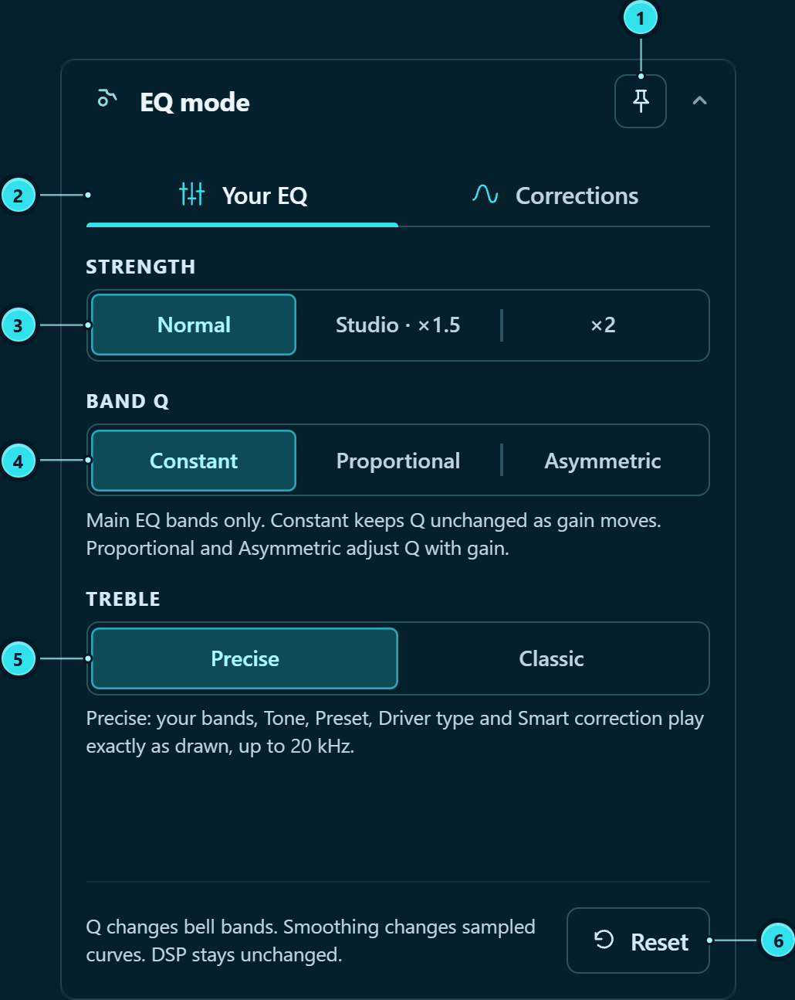

1. **Put back in the menu** — Puts these settings back in a menu over the graph. The menu’s pin brings the card back.
2. **Your EQ and Corrections** — Two tabs, each with its own settings.
3. **Strength** — Normal, Studio ×1.5 or ×2. Each tab keeps its own.
4. **Band Q** — Constant keeps each Q; Proportional and Asymmetric narrow bands as they grow. On Your EQ it shapes your own bands alone, never a preset or a correction.
5. **Treble** — Precise plays treble as drawn; Classic as Equalizer APO does. With the FluidEQ Engine only.
6. **Reset** — Everything back to Normal, and Curve smoothing back to Off.

### Band designs

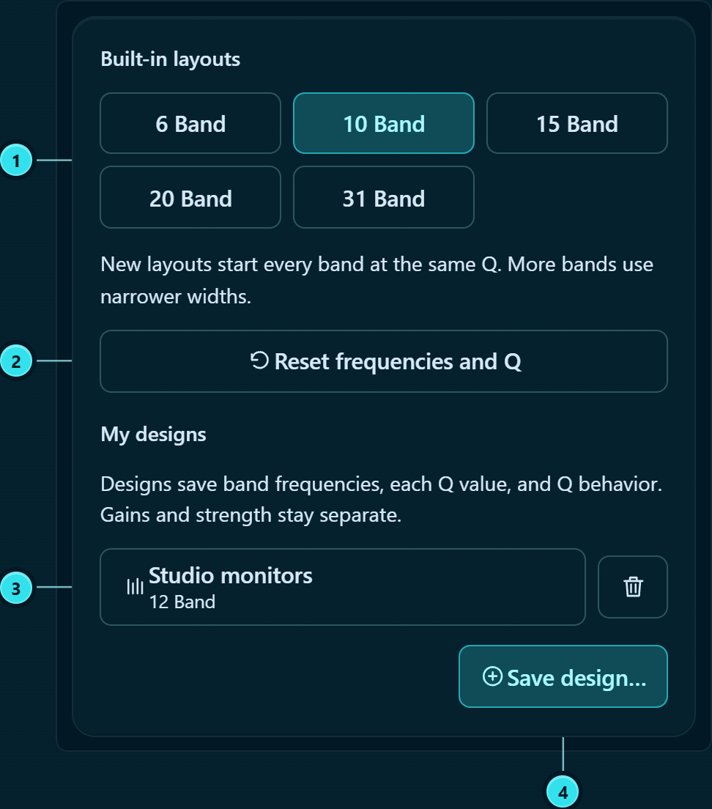

1. **Built-in layouts** — Standard layouts of 6, 10, 15, 20 or 31 bands.
2. **Reset frequencies and Q** — Puts every band back at its layout’s frequency and Q; gains stay as they are.
3. **My designs** — A design you saved: press it to load its frequencies and Q, every band at 0 dB. The bin beside it deletes it, after asking.
4. **Save design…** — Names the current frequencies and Q as a design, listed under My designs.

### Try it

1. Press EQ mode in Your EQ’s tools under the graph. Pinned, the card comes into view in the sound panel; otherwise it opens as a menu over the graph.
2. Pick the Your EQ or Corrections tab, then try a Strength or Band Q choice while music plays. Under the FluidEQ Engine choose Precise or Classic treble for each tab, and Minimum or Linear phase where a tab offers it.
3. On Corrections, Curve smoothing can soften sampled curves at 1/12 or 1/3 octave; it is Off until you choose. Reset puts everything back to Normal, and smoothing back to Off.
4. Would you rather have a menu? Press the pin on the card: EQ mode then opens as a menu over the graph, and the pin in that menu brings the card back.
5. Open the band count button in Your EQ’s tools. Pick 6, 10, 15, 20 or 31 bands, or press Save design… to name the current layout.

> **Good to know:** A new layout starts every band at one Q, and a band you add takes the Q of the others. A design stores only frequencies and Q: loading one starts every band at 0 dB. Linear phase adds delay and can ring before sharp hits. Picking a built-in layout starts it fresh: its own frequencies and Q, every band at 0 dB and on both ears.

## Gaming Lab

Give each game its own sound. A game starts from a Gaming profile made for it and gets its own copy: you tune the copy in the Gaming Lab, and the profile never changes. When the game comes to the front, FluidEQ puts its sound on and keeps it until you close the game, whatever you alt-tab to in between. Then your music sound comes back.

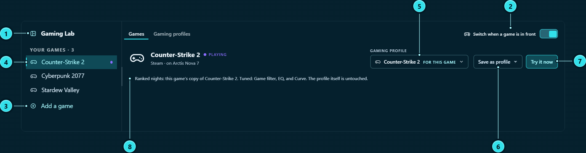

1. **Collapse the sidebar** — Your games run down the left and scroll on their own. Drag the rail’s edge to change its width. The pin folds it to the games’ icons, which open it over the page while the pointer is on them; press the pin again to keep it open. Its width and fold are remembered.
2. **Switch when a game is in front** — Lets a game in front put its own sound on. Off, your games keep your music sound.
3. **Add a game** — Adds a game from Steam, Epic, EA, GOG, Ubisoft, Battle.net or Xbox, or any program that is open now. FluidEQ, Windows Explorer, known system and launcher processes, and shared runtime installers are left out.
4. **A game** — A game. The one open is marked, and a dot at its end means it is in front now. Its tooltip says the profile its sound started from and whether you tuned it.
5. **Gaming profile** — The Gaming profile this game’s copy starts from. Picking another gives the game a fresh copy of it.
6. **Save as profile** — Saves the copy as a new profile or updates one of yours, resets it to its profile, renames it or deletes it. The profile itself never changes.
7. **Try it now** — Puts the game’s sound on now, so you hear what you tune. While it is on, Unload stands here and brings your music sound back.
8. **What was tuned** — Which parts of this copy are different from its profile.

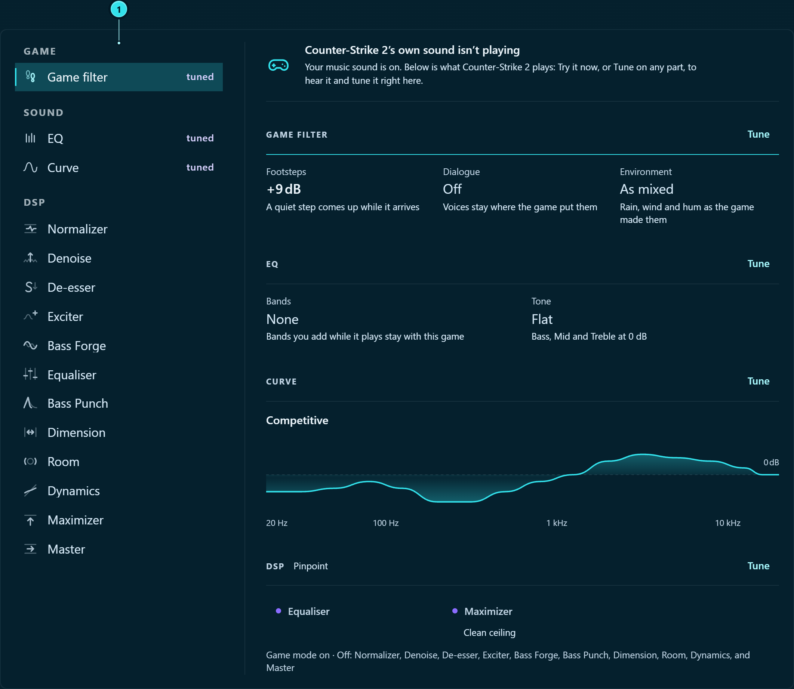

1. **Its parts** — Every part of the game’s sound, each tuned in its own editor beside the list. Tuned marks what moved away from the profile.

### Gaming profiles

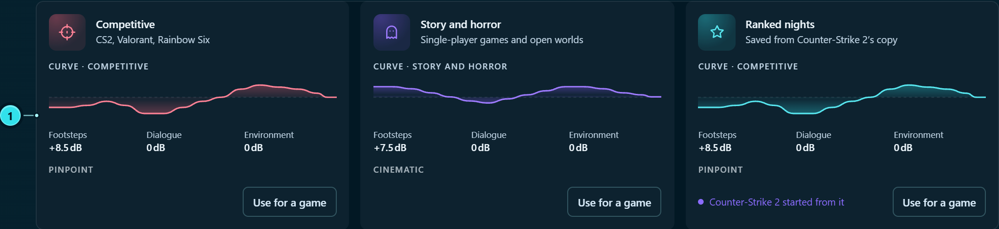

1. **Gaming profiles** — Open Gaming profiles to search by profile, game, curve or chain. The filters stay on one line and each kind of game has its own colour. Your saved profiles show their curve, Game filter levels and chain too. Use for a game starts a new copy.

### Try it

1. Open the Gaming Lab in the title bar and press Add a game. Pick one from your launchers, a program that is open now, or browse for its program. It starts from the Gaming profile suggested for it; pick another in its Gaming profile list any time. The list has 32 title-specific profiles, including Counter-Strike 2, Valorant and Fortnite, plus 9 kinds of game.
2. Press Try it now to put the game’s sound on. Pick a part on the left — the Game filter, EQ, Curve or any DSP stage — and tune it right there. Every change stays in this game’s copy.
3. Save as profile keeps the copy as one of your own Gaming profiles for other games, updates yours, resets the copy to its profile, renames the copy or deletes it.
4. Start the game. A card on the desktop says its sound is on, and another says your music sound is back when you close it. The card shows the loaded profile’s name, and names the music profile when it returns.

> **Good to know:** While a game’s sound is on, the DSP page shows your music rack paused with a button to tune the game, and the profile list rests, so nothing done there can overwrite your music profile with the game’s sound. The Game filter brings up quiet steps and reloads as they happen and puts voices forward.

## The Game filter: steps, surroundings and voices

The Game filter gives each game separate control over quiet cues, its background and dialogue. Start from that game’s profile, then tune its own copy while listening.

### Try it

1. Open Gaming Lab, select a game and press Try it now if its sound is not already on. Choose Game in that game’s parts.
2. Raise the footsteps lift for quiet steps, reloads and doors. Calm holds distracting loud events; compare before pushing both controls.
3. Hooves and heavy steps brings more of the low weight forward for boots, horses and vehicles. Leave it off when it makes cues too heavy.
4. Environment turns the game’s bed down or up. The stage lets go when a step or another distinct sound stands out, so the cue is not lowered with the background.
5. Dialogue brings a centred voice forward. Make room lowers the rest a little while somebody speaks.
6. Use Isolate to hear what Game changes, then return to the full game. Save as profile keeps your tuning for other games; resetting the game returns it to its starting profile.

> **Good to know:** A profile for a game with its own 3D audio can keep the Room off to avoid processing its positioning twice. Room profiles are for headphones. Your music sound returns when the game’s sound is unloaded.

## Headphone correction & imports

A headphone correction compensates for a measured model. It is a starting point you can combine with your own bands and presets. Check the exact model and the measurement author before applying a result.

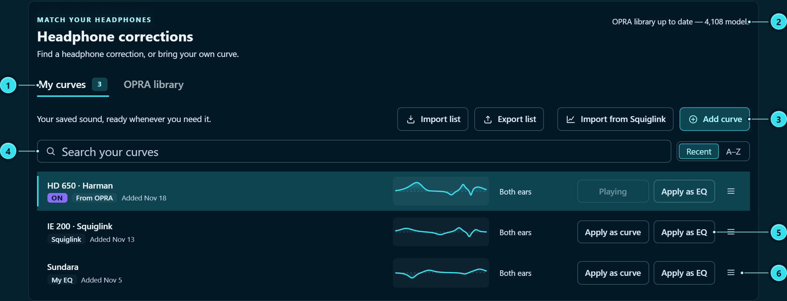

1. **My curves and OPRA** — Your own curves, with how many you keep, and OPRA’s library of measured headphone corrections.
2. **OPRA updates** — Whether OPRA’s library is up to date, with how many models it holds; when a newer one is out, Update database fetches it.
3. **Add curve** — A Squiglink export, a .txt file, your EQ as it is now or an OPRA pick, for both ears or one. Import from Squiglink beside it pastes straight from Squiglink; Import list and Export list carry the whole list.
4. **Search and order** — Finds a curve by its name; Recent and A–Z beside it order the list.
5. **Apply as EQ** — Apply as curve plays it as a correction layer and keeps your bands; Apply as EQ puts it in your bands instead (only the ears it was saved for), after asking.
6. **A curve’s menu** — Rename, edit its bands, duplicate, copy as text or delete.

### Try it

1. Open EQ → Headphone corrections. It opens on My curves, your own list; the OPRA library tab beside it holds measured corrections for thousands of headphone models. Search for your exact model and choose the matching entry.
2. For EQ text from another tool, use Import EQ settings in the actions menu. Review the parsed bands and curve before applying.
3. For Squiglink, press Import from Squiglink on My curves, paste its export and review the live curve preview, then use it as a curve or as editable EQ.
4. Add curve takes a Squiglink export, a .txt file, your EQ as it is now or an OPRA pick, and asks which ears it is for: both, the left or the right. Each curve has Apply as curve and Apply as EQ; Apply as EQ replaces only those ears’ bands, after asking.
5. A curve’s menu (≡) renames it, edits its bands, duplicates it, copies it as text or deletes it. Export list and Import list carry the whole list to another computer.

> **Good to know:** A preview marked not applied is not changing your sound. Avoid stacking two full corrections for the same headphones unless that is deliberate; compare with the headphone layer switched off.

## My curves: import, edit and share

My curves is your own library beside the headphone measurement library. Keep a curve once, inspect its response and choose whether it becomes a correction layer or editable EQ bands.

### Try it

1. Open the Headphone corrections page; it opens on My curves. Search or sort the list to find a saved curve.
2. Use Add curve for your current EQ, a text file, a measurement-library pick or pasted data, and say which ears it is for. Import from Squiglink accepts its exported EQ text. Review the preview before saving.
3. Apply as curve adds a correction layer and leaves your editable bands in place. Apply as EQ replaces the bands of the ears the curve was saved for, after confirmation.
4. A curve’s menu can rename it, edit its bands, duplicate it, copy it as text or delete it. Editing a saved curve does not require starting the import again.
5. Export list and Import list carry the whole collection between computers. Keep the measurement author and model clear when you share a correction.

> **Good to know:** A curve and a full sound profile are different: a curve describes a frequency response; an output profile also keeps the rest of that output’s sound. Check the model and source before applying a correction.

## Use an impulse response

Convolution applies a WAV impulse response as another correction layer. FluidEQ includes a searchable AutoEq catalogue and can import your own WAV. It remains separate from the editable parametric bands.

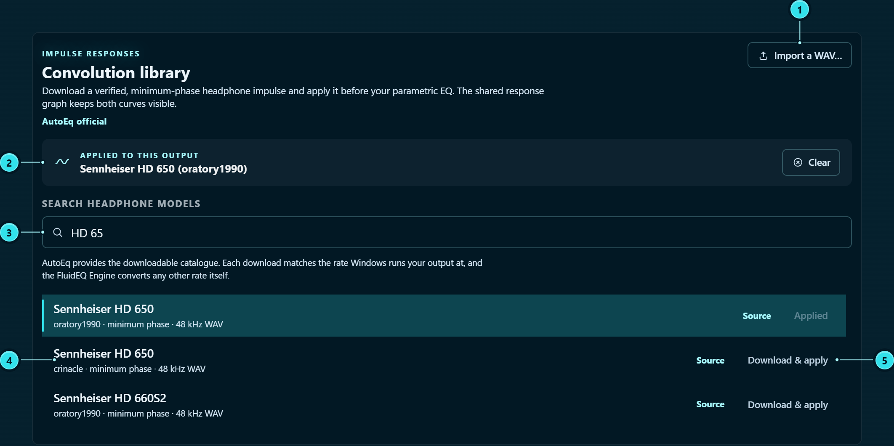

1. **Import a WAV…** — Applies a WAV you already have, at any rate under the FluidEQ Engine.
2. **Applied to this output** — The impulse this output plays now. Clear takes it off.
3. **Search headphone models** — Searches AutoEq’s catalogue by model or measurement author.
4. **A result** — The model, who measured it, and the impulse’s phase and rate. Source opens where it was published.
5. **Download & apply** — Downloads the impulse at your output’s rate and applies it. Applied marks the one playing.

### Try it

1. Open EQ → Convolution. Search by model or measurement author.
2. Check the source, then use Download & apply; the download matches your output’s rate. Use Import a WAV for a file you already have.
3. Listen with the convolution layer on and off in Curves.

> **Good to know:** The FluidEQ Engine converts any impulse rate itself. Equalizer APO needs an imported WAV at the output’s own rate. Catalogue downloads need a connection; the guide does not.

## Devices, profiles & second output

Every output keeps its own sound: the EQ, the preset, the Tone, the cuts, the DSP rack, the Room and the leveling are saved with it and come back the moment you switch to it. Profiles keep other sounds for the same output. Second output plays on another device at the same time, with a sound and a level of its own.

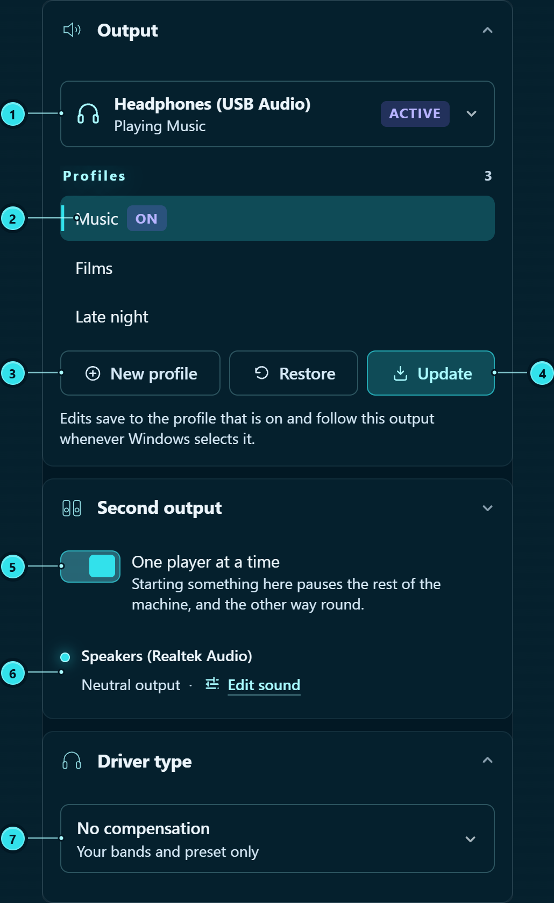

1. **Output device** — The output you are listening on, with its battery for Bluetooth headphones. OFF means your EQ does not reach it; ACTIVE, that Windows is playing through it.
2. **Profiles** — Sounds you saved. ON marks the one this output uses; press another to switch. A profile’s pencil renames it and its bin deletes it, after asking.
3. **New profile** — Starts a new profile from the EQ you have now.
4. **Update** — Saves your changes into the profile you are on. Restore, beside it, brings the profile back as you last saved it.
5. **One player at a time** — Starting something in FluidEQ pauses what plays elsewhere on the PC, and the other way round.
6. **Second output** — Your other outputs. Switch one on to play there too, with its own sound, level and delay in milliseconds. Edit sound changes its sound on the EQ page without switching the main output.
7. **Driver type** — A gentle starting point for what you listen on — headphones, earphones, a driver size or material. Leave it at No compensation if the sound is already right.

### Try it

1. Check the output at the top of the Output card before editing; Bluetooth headphones show their battery beside it. Use New profile for a sound you want to keep; Update saves changes to that profile, and Restore brings its saved settings back.
2. Each song’s own sound is in Auto EQ on the EQ page now: a song keeps its preset, Tone and EQ on every output, and the Library sets one for an album.
3. Open Second output, switch on a device and set its level. Choose its profile beneath it, or press Edit sound to change its sound on the EQ page without switching the main output; Done or Edit main takes you back.
4. Each second output keeps itself in time and shows its delay in milliseconds; with Share Audio, another computer’s sound shows its own delay, the network included.

> **Good to know:** Under the FluidEQ Engine a second output plays straight from the engine, and the main output never waits for it. Auto EQ starts switched off. On the EQ page the panel starts with the EQ mode card; fold it to reach your outputs sooner.

## Auto EQ: each song’s sound

Auto EQ, on the EQ page, decides each song’s sound: the sound saved for the song, its album’s sound from the Library, or yours. Smart correction adds a measured correction on top. A song’s sound follows it to every output; the headphone correction stays the output’s.

### Try it

1. Open Auto EQ at the end of Your EQ’s tools (it fills while any of its parts is on) and switch on Song sounds, Album sounds and Smart correction as you like; each one turns off on its own. Measure once, at the panel’s foot beside Manage, measures what plays one time and applies it at once.
2. While a song plays, press Save for this song to keep the sound you hear. When it plays again its sound comes back, and when a song with nothing saved follows, your own sound comes back.
3. Change the preset, the Tone or a band while a saved song plays and you hear it at once. Save changes keeps it for the song, and so does the Save beside Auto EQ without opening it; Restore, followed by the saved sound’s name, puts the saved sound on again. A change you leave unsaved is not kept: next time the song plays its saved sound. A change on a song with nothing saved becomes your sound instead.
4. In the Library, right-click a song, a selection or an album, or use an album’s Album sound, to choose a preset or keep what is playing now. A song’s own sound beats its album’s; albums change only in the Library.
5. Manage lists every saved song and album, with Forget. Reset all settings turns Auto EQ off and keeps them.
6. Your saved EQs are in the Save EQ menu in Your EQ’s tools: keep what plays as a named EQ, update the one that is on, put another on, or open Manage saved EQs…. A song saved while a saved EQ is on follows it: update that EQ and the song plays the new version.

> **Good to know:** Songs from Spotify, YouTube or the browser are known by the title and artist the player reports, and keep their sounds apart from the Library’s. Films and videos never get a song’s sound. Auto EQ steps aside while DSP is off, a Gaming chain is on or a game plays its own sound.

## Inspect & back up a chain

EQ → Config shows what the audio engine actually has on disk. The output cards and include tree help you see which device and layers are involved. Export a chain before a large experiment or when moving a setup.

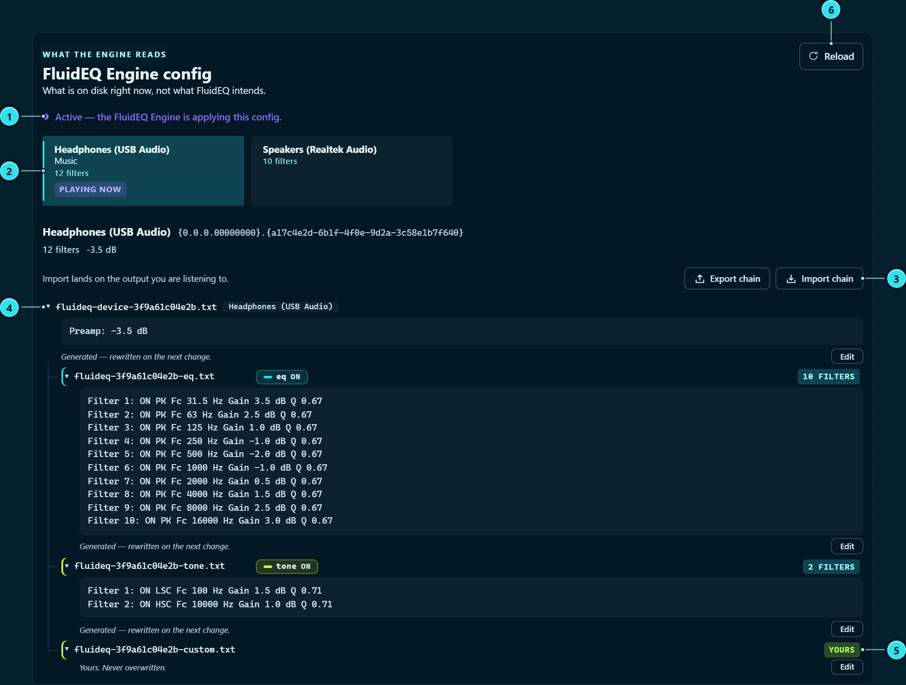

1. **Whether it is applied** — Whether the engine is reading this config at all, said before anything else.
2. **Outputs** — Each output in the config, with its profile and how many filters it applies; Playing now marks the one you hear. Press one to see its chain.
3. **Export and import** — Export chain saves this output’s chain as a .fluideq file; Import chain brings one back onto the output you are listening to.
4. **The chain’s files** — The output’s file and each layer’s file under it, in the order the engine reads them, with what each one says.
5. **Your own file** — The one file FluidEQ never rewrites: put lasting lines of your own here with Edit.
6. **Reload** — Reads the config from disk again.

### Try it

1. Open EQ → Config and choose the output you want to inspect. Read its status and active layers.
2. Use Export chain to save a .fluideq file. Keep a copy somewhere you can find again.
3. To bring a chain back, select the intended output first, then use Import chain and review the result.

> **Good to know:** Generated layer files are rewritten when their settings change; put lasting manual lines in the per-output custom file. The FluidEQ Engine reads its Filter, Preamp, GraphicEQ and Convolution lines; other APO commands and plugins need Equalizer APO.

## Explore the DSP rack

The DSP rack is a chain of studio stages. Under the FluidEQ Engine it processes everything the PC plays; under Equalizer APO it processes Library audio tracks. It is off while FluidEQ is switched off.

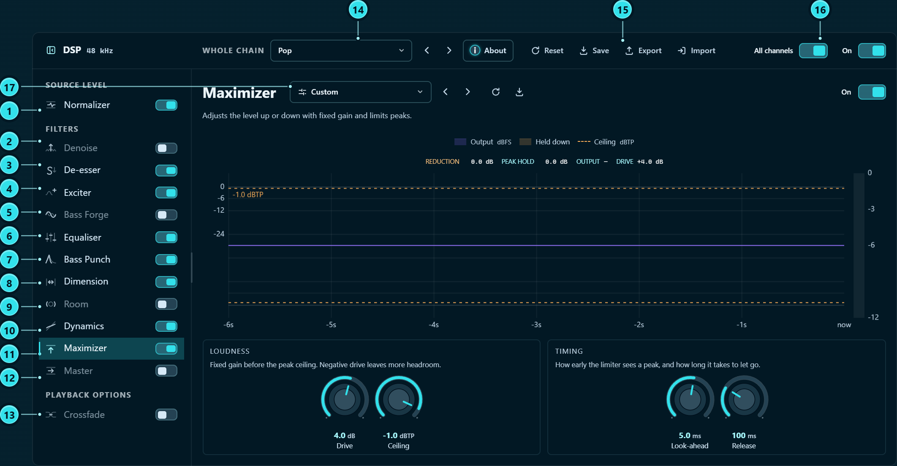

1. **Normalizer** — Evens out the source’s level before every effect: Loudness, True Peak or off. Picking a chain never changes it.
2. **Denoise** — Repairs hiss, hum and clicks. The neural voice cleaner works on Library tracks.
3. **De-esser** — The De-esser reduces sharp S, T and SH sounds when they occur. Its four groups decide what it hears, what it turns down, how fast, and where in the stereo sound it acts.
4. **Exciter** — Adds harmonics for body and air.
5. **Bass Forge** — Adds a real octave below the bass, or its harmonics for small speakers.
6. **Equaliser** — Fifteen parametric bands, with minimum or linear phase.
7. **Bass Punch** — Shapes the attack, sustain and bloom of the bass.
8. **Dimension** — Widens the stereo picture without changing the mono sum.
9. **Room** — Surround on headphones: each channel becomes a speaker in a room around you.
10. **Dynamics** — Dynamics is a three-band compressor that lifts quiet passages and holds loud ones without adding delay. Use it on music, films, speech or a game’s own sound.
11. **Maximizer** — Raises the level without letting peaks pass the ceiling.
12. **Master** — Final level, loudness target and peak safety.
13. **Crossfade** — Blends one Library track into the next.
14. **Whole chain** — Ready-made chains for music, genres, devices and repairs. Picking one sets every stage at once.
15. **Chain actions** — Reset puts the chain back; Save keeps the rack as a chain of your own; Export and Import carry it to another computer.
16. **Rack switches** — All channels runs the rack on every channel of a surround output, or on the front pair alone; On switches the whole rack.
17. **Stage preset** — The open stage’s own presets, with its arrows, Reset and Save, which keep this stage alone.

### Try it

1. Open DSP and pick a chain under Whole chain, at the top: it sets every stage at once. About opens a genre chain’s notes, with listening examples on YouTube.
2. Press a stage in the rail to open it, and switch it on with its own switch. Its preset picker sets that stage alone, and Save beside it keeps just that stage.
3. The Normalizer stands apart from the chains: picking a chain never changes it.
4. Compare with a stage off at a similar volume. Isolate, where a stage has it, plays only what that stage changes. Ctrl-click a dial to put it back.
5. Save keeps the whole rack as a chain of your own; Export and Import carry it to another computer, and Reset puts the chain back as it was.
6. All channels runs the rack on every channel of a surround output; the switch beside it turns the whole rack on or off.
7. Dynamics, De-esser, Denoise, the Room and Crossfade have chapters of their own. The Game filter is on the Gaming Lab; while a game’s own sound is on, this page rests so nothing here can overwrite it.

> **Good to know:** Louder often sounds better simply because it is louder, so compare at matched levels. Ctrl-click a dial to return it to its default.

## Normalizer and live level control

The Normalizer changes the source level before the creative stages. Library files can be measured in full; other system audio is learned while it plays. It stands apart from the chains: picking one never changes it.

### Try it

1. Open DSP → Normalizer and choose Off, True Peak or Loudness. For external audio, the same card is called Live level control, with Peak protection and Live leveling modes.
2. For True Peak, set Peak ceiling. This mode lowers a source when its peaks exceed that limit; it does not boost quieter sources.
3. For Loudness, set Loudness target and Peak ceiling. The target applies to the loudest three-second passages; clips shorter than three seconds use integrated loudness.
4. For Library playback, let Source analysis finish. Read Foreground loudness, Integrated loudness and Applied gain: the first describes the strongest passages, while the second measures the whole track.
5. For Live, play the source while Learning source is shown and watch for Holding gain. A louder passage may lower the gain; quiet passages keep their relative level.
6. Check Applied gain and any limiting reason before raising the target. Peak headroom and the boost limit can prevent reaching it. Compare at a similar listening volume; one foreground target does not make every track’s whole-song loudness identical.

> **Good to know:** This differs from Auto normalize in the left rail, which manages EQ headroom, and from Master, which trims the finished output. None can repair distortion already in a recording.

## Denoise & source analysis

Denoise reduces hiss, mains hum and clicks. Under the FluidEQ Engine it works live on anything the PC plays; the neural voice cleaner and the scanned noise floor are for Library tracks. Stronger reduction is not automatically better.

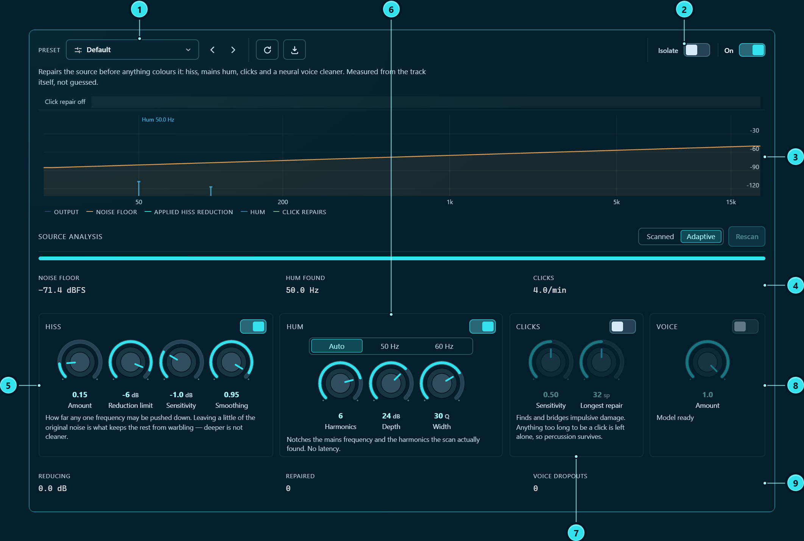

1. **Presets** — Starting points for a gentle or a strong clean-up, hiss, hum, clicks, vinyl, tape or a podcast. Save keeps your own.
2. **Isolate** — Plays only what Denoise takes away, so you can check it takes nothing you want to keep.
3. **Noise picture** — The sound against its noise floor, with the hiss reduction, the hum and the click repairs drawn as they happen.
4. **Source analysis** — On a Library track: the noise floor, the hum and the clicks a minute, measured from the file itself. Rescan measures again.
5. **Hiss** — Lowers the steady hiss under the music. Reduction limit leaves a little of it, so what remains does not warble.
6. **Hum** — Notches out mains hum and its harmonics. Auto takes 50 or 60 Hz from what the scan found.
7. **Clicks** — Finds and bridges short clicks and crackle; anything longer is left alone, so drums survive.
8. **Voice** — The neural voice cleaner, for Library playback. Its model downloads the first time you use it.
9. **What it is doing** — How much it is reducing right now, the clicks repaired, and any moment the voice cleaner fell behind.

### Try it

1. Play something with the noise you want to reduce and select Denoise in DSP.
2. Switch on Hiss, Hum or Clicks with a light setting, and listen to quiet passages and to musical detail.
3. Increase reduction gradually, then bypass the stage to check that the improvement is worth any loss of detail.
4. For a Library file, let its source analysis finish before comparing the measured noise floor or neural voice cleaner. Live system audio can use hiss, hum and click reduction, but the neural voice cleaner is for Library playback.

> **Good to know:** Listen for softened detail and watery or pumping textures. This is not a microphone cleanup. If you hear no change, confirm the rack and the stage are both on.

## De-esser: soften sharp voices

The De-esser reduces sharp S, T and SH sounds when they occur. Its four groups decide what it hears, what it turns down, how fast, and where in the stereo sound it acts.

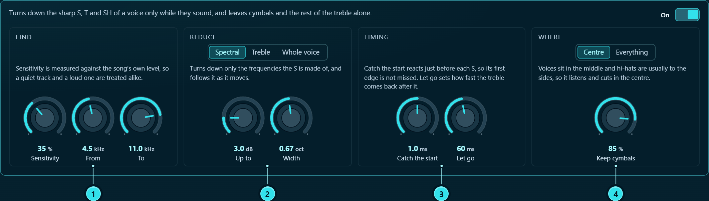

1. **Find** — Sensitivity is measured against the song’s own level, so a quiet track and a loud one are treated alike.
2. **Reduce** — Turns down only the frequencies the S is made of, and follows it as it moves.
3. **Timing** — Catch the start reacts just before each S, so its first edge is not missed. Let go sets how fast the treble comes back after it.
4. **Where** — Turns down the sharp S, T and SH of a voice only while they sound, and leaves cymbals and the rest of the treble alone.

### Try it

1. Open DSP → De-esser, switch it on and try a preset while a recording with a sharp voice plays.
2. In Find, set the lower and upper listening frequencies around the harsh sound, then raise Sensitivity until those sounds are caught without reacting to every bright note.
3. In Reduce, Spectral follows only the offending frequencies; Treble turns down the upper band. Whole voice lowers the entire sound and is intended for an isolated voice. Set how far it may reduce, and the width where available.
4. Use Timing to catch the beginning of the sound and set how quickly the treble returns. In Where, Centre only concentrates on a centred voice; Keep cymbals protects bright hits.
5. Turn Isolate on to hear only what is removed, then turn it off to judge the complete recording. The display follows the control you are adjusting and shows what the stage did.
6. Save a useful setting from the stage’s preset bar. Choosing a whole-rack chain later can replace the stage settings, so save the complete rack too if you want to keep it.

> **Good to know:** If a voice lisps or the music loses air, reduce Sensitivity or the maximum reduction. This is playback processing, not a microphone effect.

## Dynamics: quiet and loud passages

Dynamics is a three-band compressor that lifts quiet passages and holds loud ones without adding delay. Use it on music, films, speech or a game’s own sound.

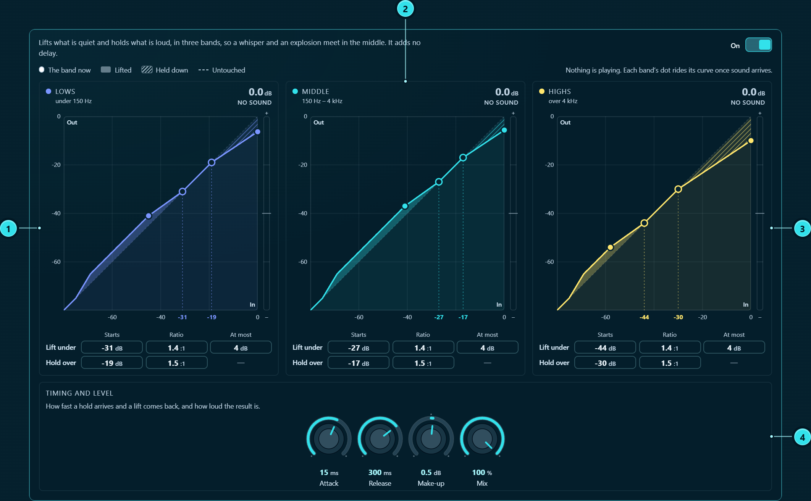

1. **Lows** — Under 150 Hz: the boom of a blast, a kick, an engine.
2. **Middle** — 150 Hz to 4 kHz: voices, steps and most of the sound.
3. **Highs** — Over 4 kHz: detail, air, the edge of a step.
4. **Timing and level** — How fast a hold arrives and a lift comes back, and how loud the result is.

### Try it

1. Open DSP → Dynamics, switch it on and choose a preset as a starting point. Everyday presets are here; presets for games are in the Gaming Lab.
2. The three bands cover lows below 150 Hz, the middle from 150 Hz to 4 kHz, and highs above 4 kHz. Tune the band containing the sound you want to change.
3. Under Lift, Below sets when quiet sound is raised, Ratio sets how strongly, and Up to limits the added gain. A ratio of 1:1 leaves it alone.
4. Under Hold, Above sets where loud sound is reduced and Ratio sets how firmly. Lowering Above makes the hold act more often.
5. Set Attack and Release for the response, Mix to blend with the unprocessed signal, and Make-up to adjust the result’s level. Compare at a similar listening volume.
6. Each band has its own curve, level in across and level out up. Drag a hollow point to set where a lift or a hold starts and a filled one to set how strong it is, or type an exact value in the table under it. While sound plays, a dot rides each curve to show what the band is doing now. If a notice asks for an Engine update, sound processing may already work while the live display needs the update.

> **Good to know:** Keep the loudness similar when comparing. Strong lift also brings quiet background noise forward; less Mix can keep more of the original movement.

## The Room: surround on headphones

The Room turns headphones into a listening room. Every channel of the sound becomes a speaker standing around your head, rendered through a measured head and the reflections of a room you shape yourself, so a film sits in front of you and a game surrounds you. It needs the FluidEQ Engine and headphones; on speakers it does nothing useful.

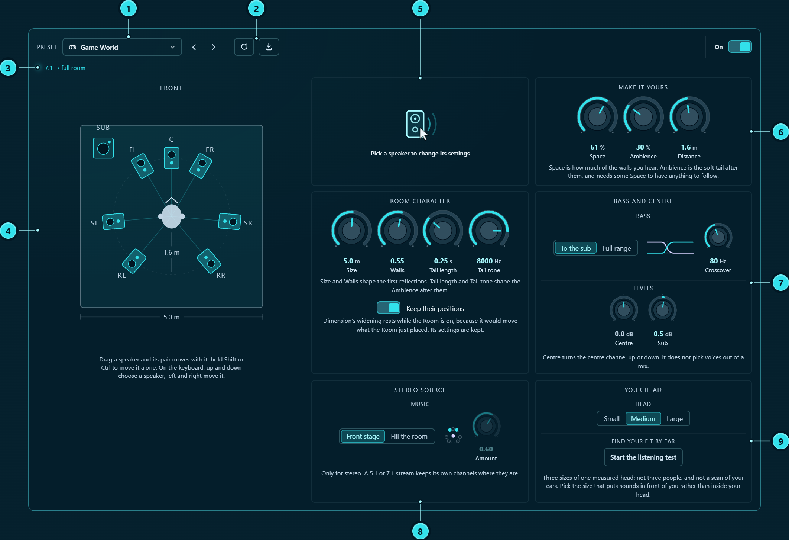

1. **Room preset** — The rooms to start from, grouped like every other stage's profiles; Custom once you shape one.
2. **Save** — Name the room as it stands; it comes back with a press.
3. **What the room is doing** — Read from the engine: which speakers the playing stream reaches, or why the room is idle.
4. **The room from above** — The room from above: walls that fade as they absorb, the speakers on their ring, the head in the middle. All of it is drawn to one scale, so a speaker standing further out than the room is wide is drawn outside its walls. Drag one and its pair moves with it; hold Shift to move it alone.
5. **The chosen speaker** — Press a speaker in the room and this pane becomes its own: its angle as a number, its own distance, its level, and Mute or Solo to hear it alone.
6. **Make it yours** — How much of the walls you hear, the soft tail after them, and how far the speakers stand. Size, Walls and the tail's own length and tone are in Room character below.
7. **Bass and centre** — Sends the speakers’ bass to the sub or keeps it full range, at a crossover you choose, and sets the centre and the sub’s levels.
8. **Stereo source** — For a stereo source only: keep it a front stage, or fill the room around you by the amount you choose.
9. **Your head** — The measured head the room renders through — small, medium or large — and the listening test that picks it for your ears.

### Try it

1. Open DSP, choose Room in the rail and switch it on. Stereo becomes two speakers in front of you; a 5.1 film five and the sub; a 7.1 game the whole ring. The line under the presets says which.
2. Pick a room under Room preset — the featured rooms first, then the classic ones and your own — or turn Space, Ambience and Distance yourself and drag a speaker around the ring. Speakers the playing stream cannot reach are drawn asleep.
3. Press a speaker: the pane beside the picture becomes its own, with its angle, its distance, its level, and Mute or Solo.
4. Under Your head, press Start the listening test and answer five short listening pairs: the room takes the head that puts sounds in front of you. Small, Medium and Large can be chosen by hand too.
5. Save a room you like under a name; a saved room comes back with a press and never changes your head.

> **Good to know:** Games and films only send their surround channels to an output Windows believes has that many speakers: when the driver takes it, the output panel offers one press to 7.1.

## Crossfade and custom fade curves

Crossfade overlaps consecutive Library tracks. Its playback settings are separate from the DSP filters and do not crossfade other apps or Karaoke.

### Try it

1. Put at least two tracks in the Library queue. In DSP, choose Crossfade under Playback options and switch it on.
2. Set Duration, then choose Equal power, Smooth or Linear. Let the first track reach its ending to hear the overlap.
3. Choose Custom to shape the outgoing and incoming fades. Drag the handles, or focus a handle and use the arrow keys to adjust it.
4. Watch both curves and the combined level. Keeping both high together can make the overlap louder.
5. Save curve keeps a shape under its own name; choose it again from the saved list. Reset shape returns the editable shape to its starting form.

> **Good to know:** If the controls are unavailable, start a Library audio track. A fade shape changes the transition between songs, not the EQ curve of either song.

## Your microphone’s sound

The Mic tab gives each microphone a voice rack of its own. The FluidEQ Engine runs it on the microphone itself, so Discord, OBS, a game or a call hears your voice as you shaped it. It needs the FluidEQ Engine.

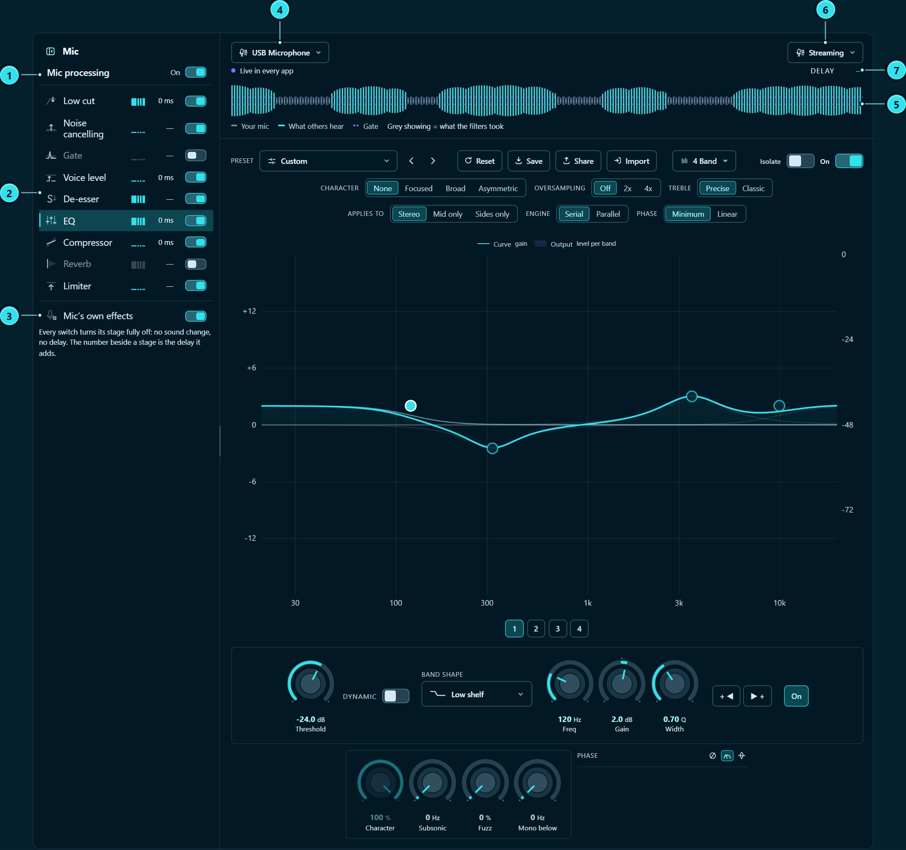

1. **Mic processing** — Turns the whole voice rack on or off for this mic.
2. **The stages** — In the order your voice meets them, each with its switch, a meter that moves with your voice and the delay it adds. Press one to open it.
3. **Mic’s own effects** — What the mic’s maker puts on your voice before FluidEQ. Its switch asks Windows for permission each way.
4. **Microphone** — The microphone you are shaping; each one keeps its own sound. The line under it says whether the engine is working on it now.
5. **Your voice** — Faint is what the mic picks up, bright is what others hear, and grey showing is what the filters took.
6. **Mic profile** — Ready-made voice sounds by use, by mic, for singing and as voice effects. A change marks the profile tuned; Reset brings it back.
7. **Delay** — How much the whole rack delays your voice, as the engine measures it.

### Try it

1. Open Mic in the header and choose your microphone at the top. If FluidEQ is not on it yet, press Set up on this mic; Windows asks for permission once.
2. Pick a Mic profile by use — Streaming, Podcast, Game chat, Meetings — by mic, for singing, or a voice effect. It sets every stage for a voice; a stage you change marks the profile tuned, and Reset brings it back.
3. Press a stage in the rail to open it. Each has its own switch, a meter that moves with your voice and the delay it adds; a stage switched off is gone from the sound completely.
4. Speak and watch the picture: faint is what the mic picks up, bright is what others hear, and grey showing is what the filters took. Hear the final result plays it back to you; wear headphones, or it howls.
5. Mic’s own effects shows what the mic’s maker puts on your voice before FluidEQ. Switching them off stops the voice being cleaned twice; Windows asks for permission, and switched on again they come back exactly as they were.

> **Good to know:** A stage switched off leaves the voice untouched and adds no delay, so if Delay reads high, switch off what you do not need. Under Equalizer APO the Mic tab has nothing to run on.

## The graph and its controls

The response graph draws your EQ curves over the live sound. Its options rest out of sight and come back under the pointer: the legend in one corner, View and full screen in the other, and along the foot the gallery of looks, the one on the graph in the middle with its switches, the ones before and after it at the ends. What the gallery offers changes with the look: a standard style or a scene.

### With a standard style

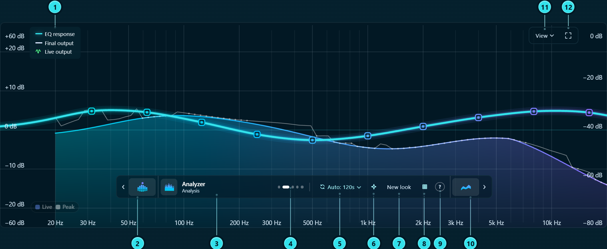

1. **Legend** — The name of every curve drawn, and Live output for the wave. Press one to hide or show its drawing; the sound stays the same.
2. **Previous style** (`Ctrl+Space`) — Steps back to the previous look.
3. **Styles and scenes** — Opens every style and scene.
4. **Place in the walk** — Where this look stands among the ones the arrows step through.
5. **Automatic scene switching** — Changes the look every 10 seconds to 2 minutes.
6. **Colouring** — Colours the style: Auto, Flat, Frequency, Level or Heat.
7. **New look** — Designs a look of your own from this style.
8. **Grid** (`Ctrl+G`) — Shows or hides the grid and scales.
9. **How to edit on the graph** — Point at it for the moves: drag a point, Ctrl or Shift to select, Ctrl+scroll for Q, Ctrl+drag to move a group as a bell.
10. **Next style** (`Space`) — Steps forward to the next look.
11. **View** — What the graph draws and how: every curve, the labels, the legend, the wave, the grid, the frequency range and the meter.
12. **Full screen** (`Ctrl+F`) — The graph fills the screen.

### With a scene

1. **The scene and its maker** — Which scene is playing and who made it. Press it to choose another style or scene.
2. **Like** — Likes the scene playing, which gives its maker points. On a scene of your own it shows how many likes it has.
3. **Dynamic lighting** — Lights your RGB devices with this scene.
4. **Set as desktop background** — Puts this scene behind your desktop icons.

### The View menu

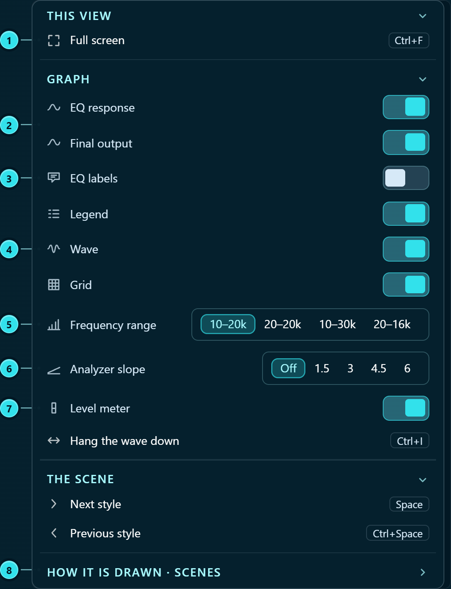

1. **Full screen** (`Ctrl+F`) — The graph fills the screen.
2. **Curves** (`Ctrl+W`) — A switch for each curve the graph draws, in the order they are applied. Ctrl+W walks Wave only, Wave with curves and Curves only; Ctrl+S walks back.
3. **EQ labels** — Each band’s frequency, Q and gain over its point.
4. **Wave** — The live wave of what you hear, drawn in the look you chose.
5. **Frequency range** — How much of the spectrum the graph spans: 10 Hz–20 kHz to start with, 20 Hz–20 kHz, 10 Hz–30 kHz, or 20 Hz–16 kHz where records have sound. With the grid off it spans 20 Hz–16 kHz.
6. **Analyzer slope** — Tilts the analyzer by up to 6 dB per octave, so music, which falls towards the treble, reads flatter. Off by default; only on styles that draw the analyzer.
7. **Level meter** — The output meter in the left rail.
8. **How it is drawn** — Frame rate, resolution and smoothing, kept apart for standard styles and scenes.

### Try it

1. Click the look’s name to choose a style or scene. The arrows beside it, Space and Ctrl+Space step through them.
2. Open View for what the graph draws — every drawing has its switch, each curve its own — the frequency range, the wave’s height and position, and How it is drawn: the frame rate (every frame your display offers, or 60 or 30, held at 60 on battery), the resolution and smoothing. Standard styles keep their own choices, apart from scenes.
3. A scene adds its own controls to View — whatever its author left for you to set — and Use its own wave puts the wave back to the height and position that author chose.
4. Double-click the plot to fill the screen with it, and double-click again to come back. In full screen the window’s top edge brings the header and its bottom edge the transport; a click puts them away.
5. Keys: Ctrl+F full screen, Esc back, Ctrl+G the grid, Ctrl+W and Ctrl+S walk Wave only, Wave with curves and Curves only, Ctrl+I which way the wave faces, Ctrl+A every band. On a band’s point, drag to move it, use the arrow keys to step it, and right-click for its menu; Ctrl+scroll changes the Q of a selected point.
6. Press a curve’s name in the graph legend to hide or show its drawing. This leaves the sound unchanged. Remove or change the layer under Curves when you want to change what you hear.

> **Good to know:** Everything here changes only the drawing, never your sound.

## Styles and scenes

Standard styles are free drawings of the live sound that you can colour and design yourself: Spectrum wave for a clean trace, LED bars and Neon bars for punch, Skyline, Glass towers and Echo for whole scenes. Scenes are living pictures drawn on the graphics card, such as Alpine, Aurora, Bloom and Neon City, where the bass, the beat and the treble each move something different.

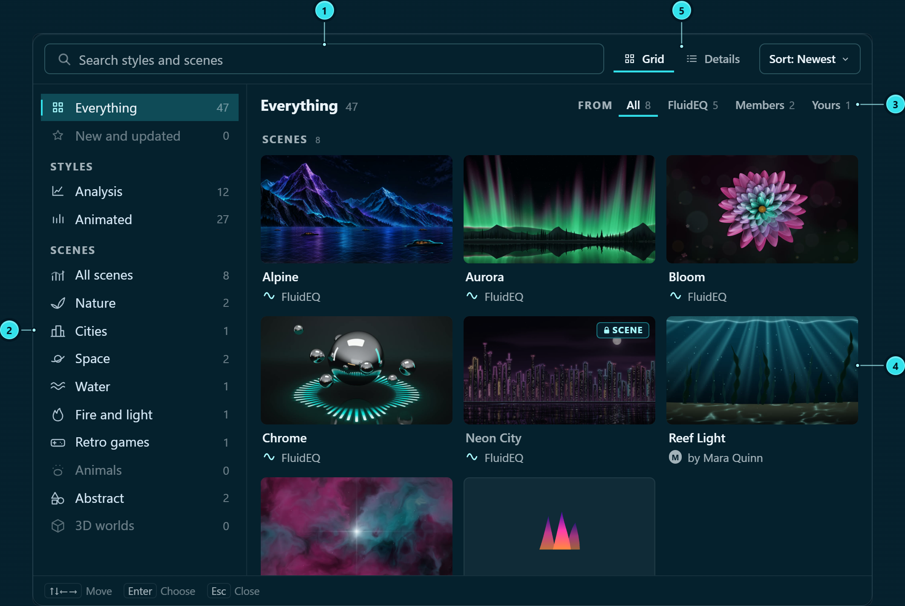

1. **Search** — Finds styles and scenes by name, maker or category.
2. **Places** — Everything, New and updated, the kinds of style and every category of scene, each with how many it holds.
3. **From** — Who made it: FluidEQ, members, or you.
4. **Styles and scenes** — Each look as a picture. New or Updated marks what changed, and Playing marks the look on the graph.
5. **View and order** — Pictures or a detailed list, sorted by newest, recently updated, name or most used.

### Try it

1. Click the look’s name on the graph. Choose a place on the left, or search everything at once.
2. Use From to see only FluidEQ’s looks, members’ scenes or your own. A scene that is not yours yet is locked, and choosing it explains how to get it.
3. On a standard style, press New look to change its colours, motion and peaks, then save it; it appears under From: Yours.

> **Good to know:** A scene brings its own colours: set its attack and release in View. Standard styles have graphics settings of their own in View, apart from scenes: full resolution and plain scaling to start with. If a scene cannot run on this computer, the graph draws a free style instead of a blank plot.

## Your account, credits and the Scenes tab

An account is optional: everything that was free runs on this computer without one. Signed in, the Scenes tab holds the Gallery, the Studio, Dynamic lighting and the desktop background. A scene from the Gallery costs one credit and is yours for good; a confirmed account gets 1 credit free, and packs of credits are paid once.

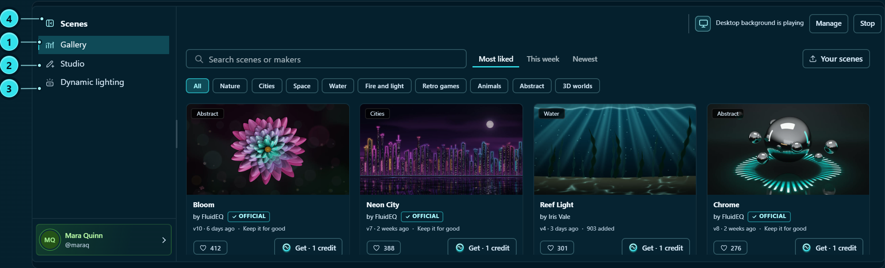

1. **Gallery** — Scenes by FluidEQ and members, ready for your music.
2. **Studio** — Make your own scenes with your AI.
3. **Dynamic lighting** — Your RGB devices follow the scene.
4. **Collapse the sidebar** — Folds the rail to its pictures; it opens again on hover.

### Try it

1. Open the Scenes tab and press Sign in, or Create your free account and type the six-digit code sent to your email. Once you are in, your account is the card at the foot of the tab’s left rail.
2. Choose Gallery. Open a scene, watch it, and press Get to spend a credit on it.
3. For more credits, open your account from that card and choose a pack. It is paid once on Stripe, in your browser.

> **Good to know:** The app never sees your card, and nothing renews. An account stays signed in on up to five computers.

## The Scenes gallery

The gallery brings together FluidEQ’s own scenes and scenes published by members. Anyone with an account can browse the gallery. If a scene has a published preview, its silent ten-second clip loops until you move on. Scenes without a clip show their cover. A scene you get with a credit plays with your music and stays in your looks.

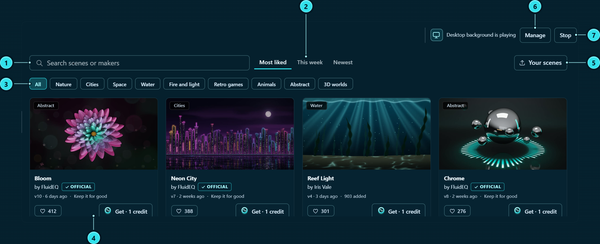

1. **Search scenes or makers** — Finds scenes and makers.
2. **Sort** — Most liked, liked this week, or newest.
3. **Categories** — Shows one kind of scene.
4. **A scene** — Its picture opens the scene. Get keeps it with a credit, and the heart likes it.
5. **Your scenes** — The scenes you published, with their likes.
6. **Manage** — What each monitor shows as a desktop background.
7. **Stop** — Stops every desktop background.

### A scene's page

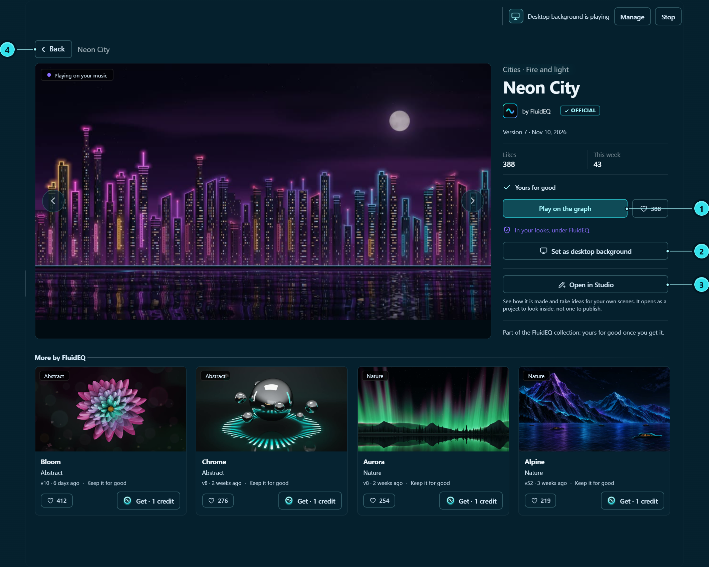

1. **Play on the graph** — Plays the scene on the graph. A scene you do not have yet offers Get, for one credit.
2. **Set as desktop background** — Puts the scene behind your desktop icons.
3. **Open in Studio** — Opens FluidEQ’s scene in the Studio to see how it is made.
4. **Back** — Back to the gallery, where you left it.

### Try it

1. Open Scenes → Gallery. Search, sort by Most liked, This week or Newest, or pick a category.
2. Open a scene and press Get to keep it with a credit, then Play on the graph. The arrows, or ← and →, step between scenes.
3. Like the scenes you have with the heart, and report one that should not be there.

> **Good to know:** Scenes in your looks update themselves, and a scene’s page says what changed in each version. A scene you publish appears once FluidEQ’s maker has approved it. Open in Studio shows how FluidEQ’s own scenes are made. A 3D scene says so on its card and its page, with the keys that move its camera. While a scene plays, View → Window colours chooses what the window wears: Original, Colours or Ambient.

## Make scenes in the Studio

The Studio turns a description into a scene. Your own AI assistant writes the scene in a project folder, and FluidEQ plays each version on your music the moment it is saved. The Studio is free for every account.

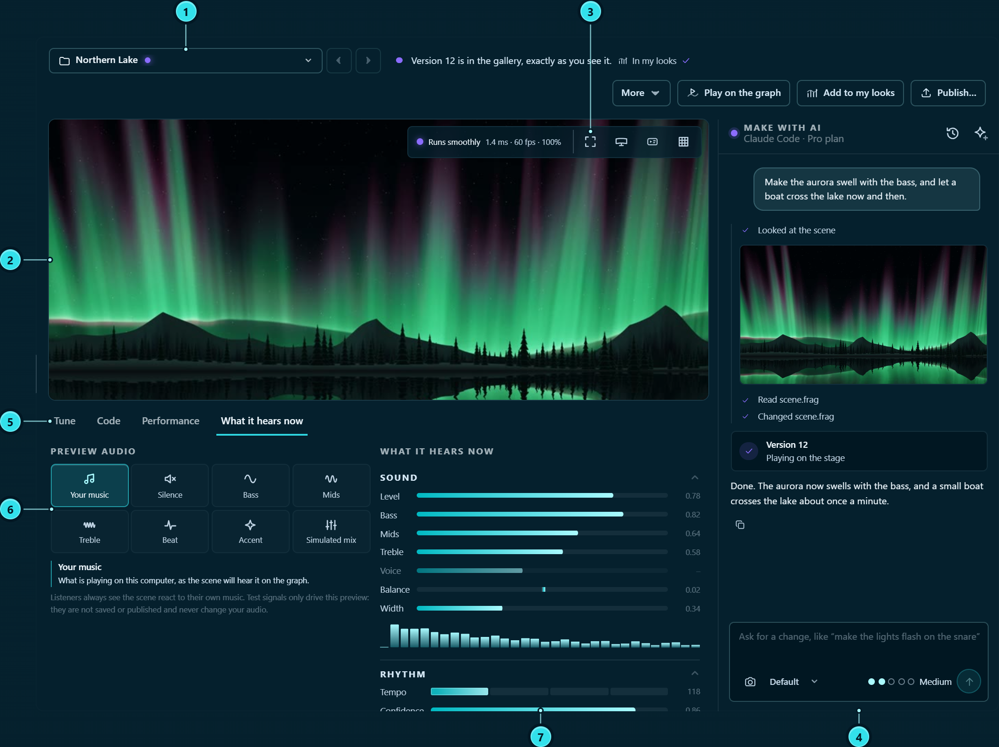

1. **Project** — Your projects, and FluidEQ scenes to look inside.
2. **Stage** — The scene, playing on your music. Double-click for full screen.
3. **Fullscreen** — Tries the scene full screen.
4. **Make with AI** — Ask Claude for a change in your own words. Each reply that changed the scene can bring that version back.
5. **Work on the scene** — Tune tries the wave and the scene’s own settings, Code shows its code as your AI saves it, Performance how it runs here, and What it hears now is open below.
6. **Preview audio** — Test signals that drive only this preview.
7. **What it hears now** — What the scene receives: level, beat, bass, mids, treble.

### Try it

1. Open Scenes → Studio and press New project…. Give it a name; FluidEQ makes its folder with a scene that already moves.
2. Describe your idea, open the folder in your AI assistant, and paste the prompt from Copy AI prompt.
3. Or type what should change in the chat beside the stage: Claude Code on this computer, signed in with your own plan, edits the scene and plays each version. Every reply keeps its version, with Bring back.
4. Watch the stage as files are saved and try the test signals. Then Add to my looks, Publish… or Export….
5. In Publish…, write a line about the scene or press Write with AI, then Send for review: FluidEQ records the silent ten-second preview for the Gallery on the demo song as it sends.

> **Good to know:** Double-click the stage for full screen. Look inside a FluidEQ scene… opens one of FluidEQ’s own scenes to learn from; it cannot be published. Scenes that flash hard or run too heavy are held back. A scene you publish is read by FluidEQ’s maker first, and once it is approved it plays free for you everywhere.

## The desktop background

The desktop background puts a scene behind your desktop icons, on one monitor or on each of them, for as long as FluidEQ runs.

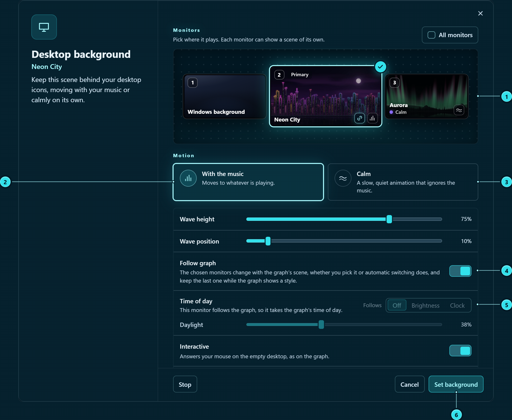

1. **Monitors** — Your monitors as Windows arranges them. Press the ones to use.
2. **With the music** — Moves to whatever is playing.
3. **Calm** — A slow, quiet animation that ignores the music.
4. **Follow graph** — Changes with the scene on the graph, whether you pick it or automatic switching does.
5. **Pause on battery power** — Saves power while the computer is unplugged.
6. **Set background** — Starts it on the monitors you chose.

### Try it

1. Put a scene on the graph and press the monitor button beside its name, or choose View → Set as desktop background.
2. Press the monitors on the map, choose With the music or Calm, and press Set background.
3. To change or stop it, open Scenes → Gallery and use Manage or Stop at the top.

> **Good to know:** It pauses while windows cover the monitor, while the PC is locked and, if you choose, on battery power, and returns when FluidEQ starts. Quitting FluidEQ stops it. Windows only.

## Dynamic lighting (beta)

Dynamic lighting lights your keyboard, mouse, mousepad, headset and stand with the scene on the graph, through Windows Dynamic Lighting and Razer Chroma. It is in beta, so tell us how your devices behave.

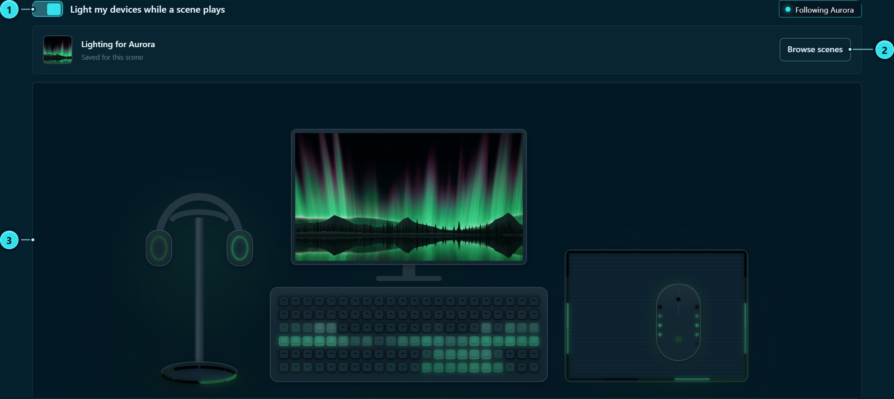

1. **Light my devices while a scene plays** — Lights your devices while a scene plays.
2. **Browse scenes** — Opens the gallery to choose a scene.
3. **Live desk preview** — Your own desk, lit with the colours sent to it.

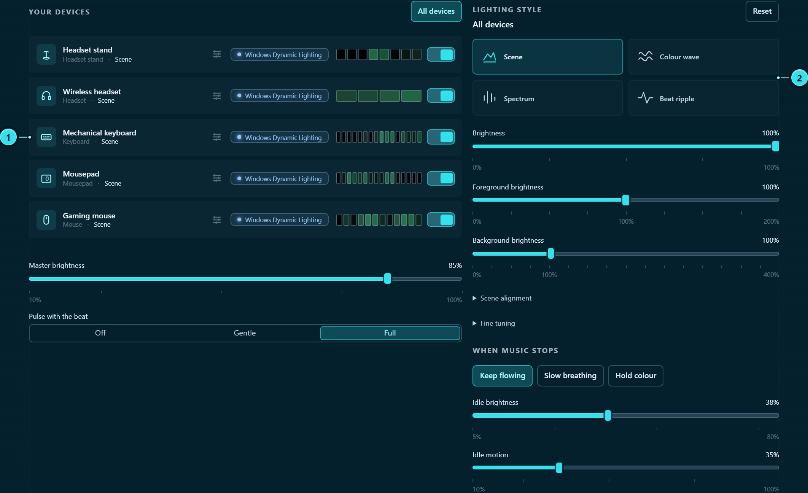

1. **Your devices** — Every device found. Click one to tune it alone; All devices, above the list, tunes them all at once again.
2. **Lighting style** — Scene, Colour wave, Spectrum or Beat ripple, kept for each scene.

### Try it

1. Open Scenes → Dynamic lighting and switch it on, or press the lighting button beside a scene on the graph.
2. Choose this scene’s lighting style — Scene, Colour wave, Spectrum or Beat ripple — and set its brightness and what it responds to.
3. Click a device under Your devices to tune it alone; All devices goes back to every device.

> **Good to know:** If Windows keeps a device for another app, the page names the setting to change and opens it for you. Razer devices need Razer Synapse running, with Chroma Apps allowed.

## Listen with Online Media

Online Media plays YouTube, YouTube Music, Bandcamp, Twitch and Suno inside FluidEQ, laid out like the Library: the sites and your recent searches down the rail, the bar over the page. What plays goes through your EQ like any other app; playback and sign-in are each site’s own.

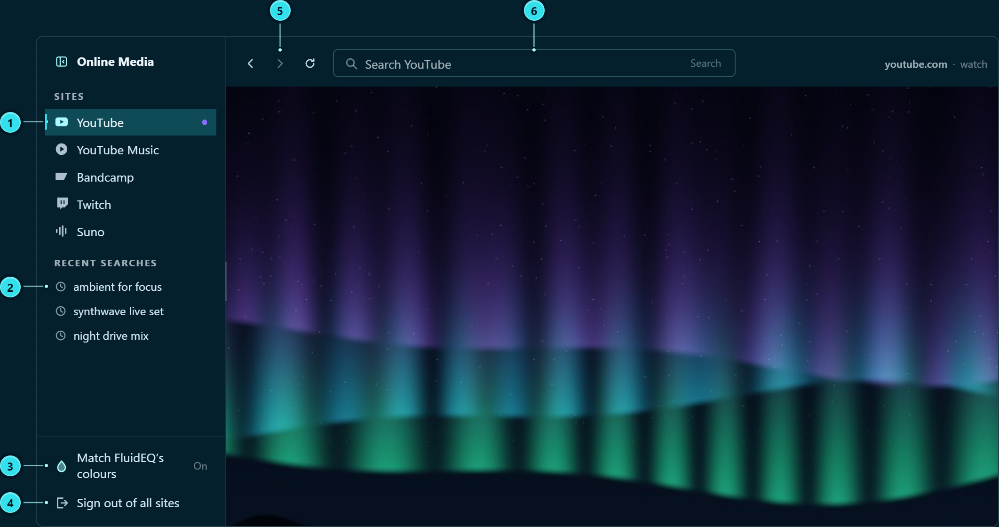

1. **Sites** — The sites. A dot beside one says it is playing. The pin above them folds the rail to its icons.
2. **Recent searches** — What you searched before. Press one to search the open site again; its × forgets it.
3. **Match FluidEQ’s colours** — Colours the site’s page to match FluidEQ, on your screen only. Videos, pictures and logos are never changed, and sites with light pages keep their own.
4. **Sign out of all sites** — Clears every login, cookie and cached page the player holds.
5. **Back, forward and reload** — Move through the pages you opened on the site, or load the page again.
6. **Search the current site** — Searches the site that is open, and keeps the search in Recent searches.

### Try it

1. Pick a site on the rail. Search it from the bar, or find something on its page and start it.
2. Press a recent search to run it again on the site that is open.
3. Go to another tab while it plays: the page keeps playing, and the bar at the foot of the window follows it.
4. Turn on One player at a time if FluidEQ and other players should pause each other instead of overlapping.

> **Good to know:** Under the FluidEQ Engine, Online Media goes through your EQ and the DSP rack like every other app. Under Equalizer APO the rack stays with Library tracks.

## Browse and tidy your Library

The Library gathers the music and videos on your drives in one page: the shelves down the rail, a bar to find and lay them out, and where you are under it. Covers and details come from the files’ tags, which the tag editor puts right.

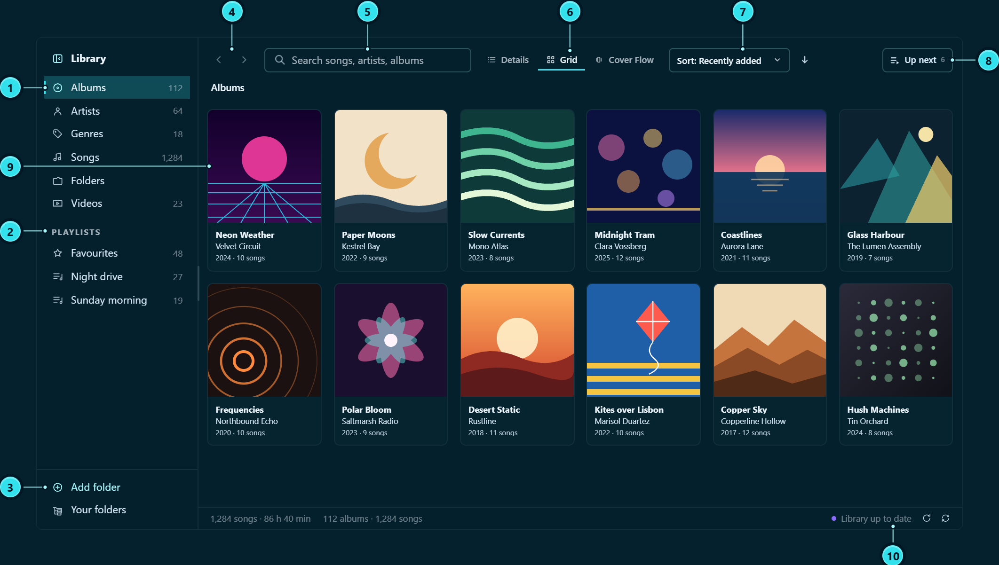

1. **Shelves** — What the Library holds, with how much is on each. Folders opens a tree of your folders under it.
2. **Playlists** — All your playlists, where a new one is made; Favourites and your own under it.
3. **Add folder** — Adds a folder of music or videos. Your folders, under it, lists them and removes one.
4. **Back and forward** — Steps back and forward through the places you opened.
5. **Search songs, artists, albums** — Finds songs, artists and albums in the whole Library.
6. **How the library is shown** — Details, Grid or Cover Flow, on every shelf.
7. **Sort** — Orders the shelf by title, artist, year, recently added, most played and more. The arrow turns the order round.
8. **Up next** — Opens and folds the right pane: the song playing, Up next, Details and Lyrics.
9. **Album** — Opens the record. Right-click it to play all of it, queue it, add it to a playlist or edit its tags.
10. **Rescan** — Says whether the Library is up to date. Rescan reads your folders again for changes; Force rescan, beside it, reads every file afresh.

### An album in the tag editor, after Fix tags

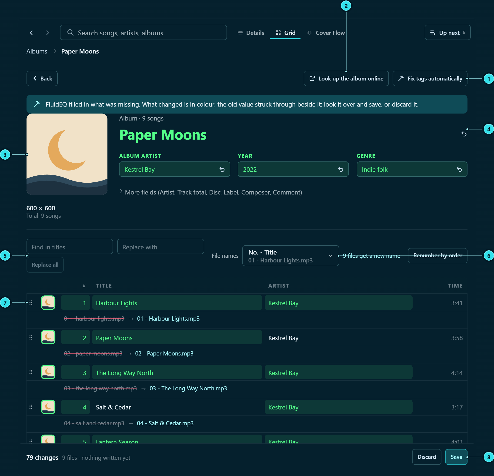

1. **Fix tags automatically** — Fills in what is missing from the file names, the folder’s name, a .cue sheet and what most songs agree on, with the folder’s picture as the cover. Nothing is looked up online.
2. **Look up the album online** — Opens the album on MusicBrainz in your browser. FluidEQ downloads nothing.
3. **Change cover** — One cover for every song. Press it to choose a picture, paste one or search for one, or drop an image on it.
4. **Album** — Values typed once for every song. What changed is in colour, a replaced value struck through under it; the arrow puts the old one back.
5. **Find in titles** — Finds words in every title and replaces them at once.
6. **File names** — Renames the files from their tags by a pattern. Each new name shows under its song, the old one struck through.
7. **Songs** — Each song’s number, title and artist, edited like a spreadsheet. Drag a row by its grip, then press Renumber by order.
8. **Save** — Writes the changes; nothing on disk changes before. Discard drops them all.

### Changes: what Save will write

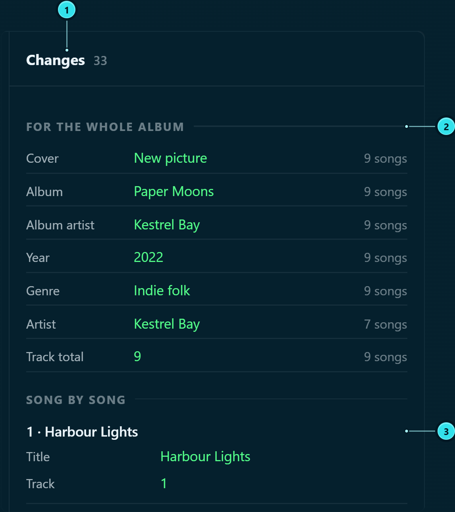

1. **Changes** — Everything Save will write, counted. It takes Up next’s place while the editor is open.
2. **For the whole album** — What changes on every song. A value filled where there was none is green; a replaced one shows the old value struck through.
3. **Song by song** — Each song’s own changes, then the files that get a new name.

### Try it

1. Press Add folder at the foot of the rail and choose the folder with your music. The status line under the page says when the Library is up to date.
2. Pick a shelf: Albums, Artists, Genres, Songs, Folders (your folders open as a tree under it), Videos, or a playlist. A video plays in the page, with a Subtitles tab for its captions.
3. Search from the bar, show the shelf in Details, Grid or Cover Flow, and order it with Sort. The arrows step back and forward through where you have been.
4. Open a record, an artist or a folder for its songs. An artist’s name, wherever it is shown, opens their page: their records and every song they are on.
5. To fix tags, right-click a song, several songs or a record and choose Edit tags (Ctrl+I) or Fix tags automatically (Ctrl+Shift+I). One song opens beside the page; an album, a folder or a selection opens as the page.
6. Look the changes over and press Save. The files are written in the background, and the card in the corner offers Undo, which puts the old tags back.

> **Good to know:** Hover FluidEQ’s button on the Windows taskbar for Previous, Play and Next, even while it is minimized. Drop music on the Library to play it. The Library needs the files where it found them: plug a drive back in, or add a moved folder again.

## Records, Up next and lyrics

A record opens under its cover without stopping what plays. Beside it, the right pane holds the song playing over three tabs: Up next, the song’s Details and its Lyrics.

### A record, open

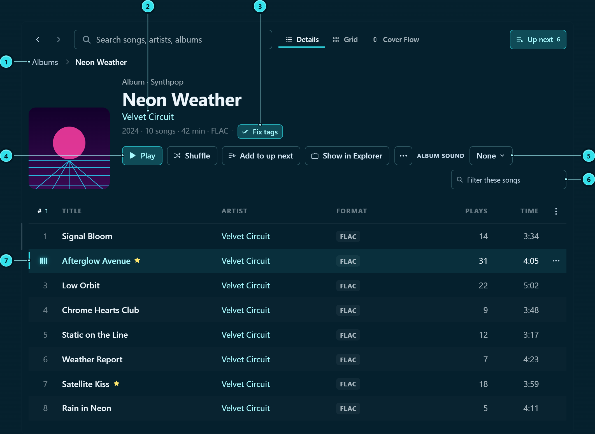

1. **Where you are in the library** — Where you are: the shelf, then the record. Press the shelf to go back to it.
2. **Artist** — Opens the artist’s page: their records, and every song they are on.
3. **Fix tags** — Opens the record in the tag editor with Fix tags’ proposals typed in.
4. **The record’s buttons** — Play, Shuffle, Add to up next, Show in Explorer, and the record’s menu: Favourites, playlists, Edit tags and more.
5. **Album sound** — A sound for this album, a saved EQ or a preset, that plays with any of its songs.
6. **Filter these songs** — Narrows this record’s songs as you type. The bar’s search looks through the whole Library.
7. **The songs** — Press a song to play it. The bars mark the one playing, the star your Favourites; right-click for its menu.

### The right pane, on Up next

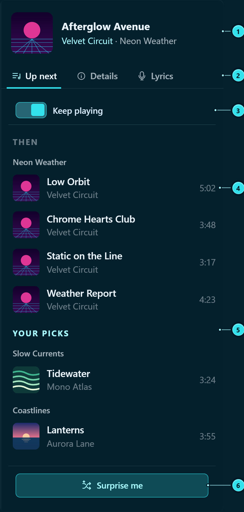

1. **Now playing** — The song playing. Its artist’s name opens their page.
2. **What the pane shows** — Up next, the song’s Details (its file, format and loudness), and its Lyrics. For a video the last tab is Subtitles.
3. **Keep playing** — When the list runs out, carries on with more of the same genre, then a surprise.
4. **What plays next** — The rest of what you were playing, headed by its record. Press a song to play it now, drag it to reorder, point at it for its ×.
5. **Your picks** — Songs you added, after the rest of the record, in the order you added them.
6. **Surprise me** — A random song from your Library now, then more of its style.

### Lyrics, and Find other lyrics

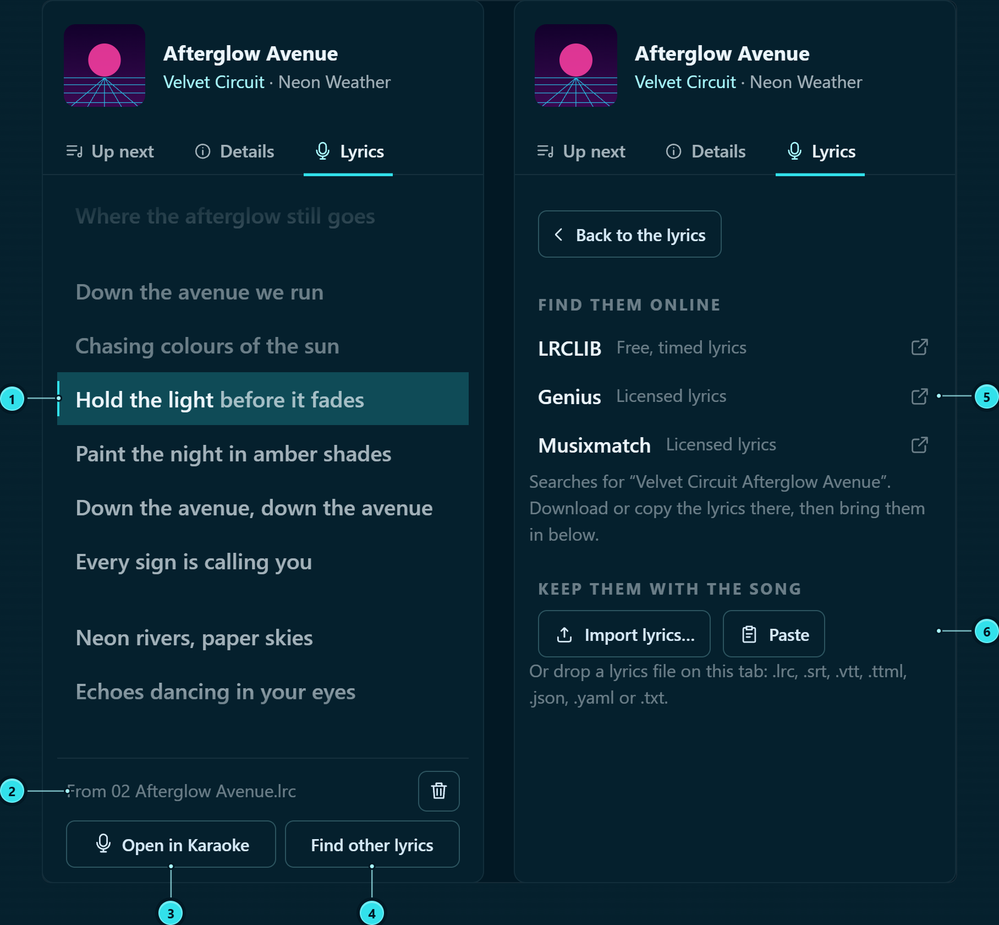

1. **Lyrics** — The line being sung, lit word by word. Press any line to play from it.
2. **Where they came from** — The song’s tags, or the lyrics file beside it, by name. The bin deletes a lyrics file kept with the song; words inside the song’s own file are never changed.
3. **Open in Karaoke** — Starts a karaoke from these lyrics in the Karaoke Maker, where their timing can be fixed.
4. **Find other lyrics** — Opens the finder, shown on the right, to bring in other lyrics.
5. **Find them online** — Searches the song on LRCLIB (free, timed lyrics), Genius or Musixmatch, in your browser. FluidEQ fetches no lyrics itself.
6. **Keep them with the song** — Keeps the words with the song: a file you downloaded, pasted words, or a file dropped on the tab (.lrc, .srt, .vtt, .ttml, .json, .yaml or .txt).

### Try it

1. Open a record and press Play, or press a song to start there. A second press on a song starts it again from the top.
2. Right-click a song for Add to up next, Add to Favourites or Add to playlist; pick several with Ctrl or Shift.
3. In Up next, press a song to play it now, drag it to change the order, or point at it and press × to take it out.
4. Turn on Keep playing to go on with more of the same genre when the list runs out. Surprise me, at Up next’s foot and on the playing bar, starts a random song from your Library and carries on in its style.
5. Lyrics shows the song’s words from its tags, or from a .lrc or .txt file of the same name beside it. Timed lines follow the song word by word.
6. No lyrics, or the wrong ones? Find other lyrics searches the song online in your browser. Import the file you download, paste the words, or drop the file on the tab; FluidEQ keeps them with the song.

> **Good to know:** Open in Karaoke turns a song’s lyrics into a karaoke in the Karaoke Maker, where their timing can be fixed. On Windows, drop music files or folders on the Compact player to add them to the Library and queue them.

## Sing with Karaoke

Karaoke puts your own songs on a stage: the words as they are sung, the chords, and a pitch strip that draws your voice against the song's notes and scores every line. Your songs stand in a list beside it, as in the Library, and a song plays through the Library's player, with your sound settings.

### The stage: the words, the chords, your pitch and your score

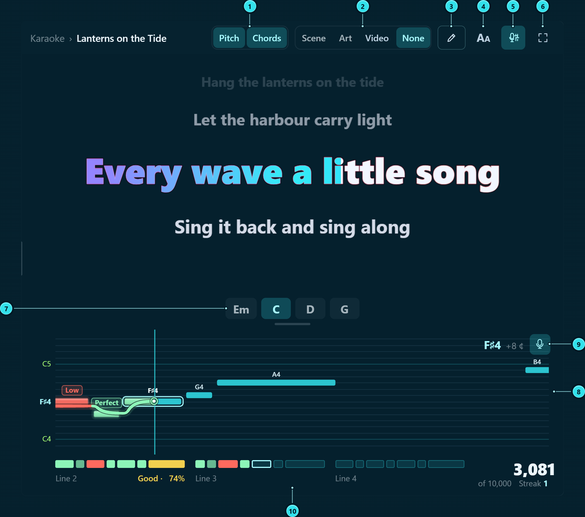

1. **What the stage shows** — Pitch shows the strip of notes, Chords the chord chips. Each turns on and off by itself; with both off the stage shows only the words.
2. **Background** — What stands behind the words: the scene, the song's cover art, its video, or nothing. Art and Video are there when the song brings them.
3. **Open in Maker** — Opens this song in the Karaoke Maker, to fix its timing, its words or its notes.
4. **Lyric text size** — Makes the words bigger or smaller for the distance you sing from.
5. **Microphone settings** — Which microphone to sing into, how loud it hears you and its volume. It lights up while the microphone is on.
6. **Enter full screen** — Gives the whole window to the stage; double-clicking the stage does the same. In full screen two more buttons here keep the header or the player bar on screen.
7. **Chords** — The chord just played, the one sounding now, lit, and the next two.
8. **Pitch lane** — The notes to sing as boxes, and your voice as a line through them: green in tune, yellow close, red off. Drag it to move through the song, and drag the handle above it to make it taller.
9. **Turn on mic** — Turns the microphone on or off. While it listens, the note you are singing shows beside it.
10. **Score** — Each line as a row of cells, one for each note, in its verdict's colour, with your running score and your streak. Press a line to sing it again.

### Your songs, beside the stage

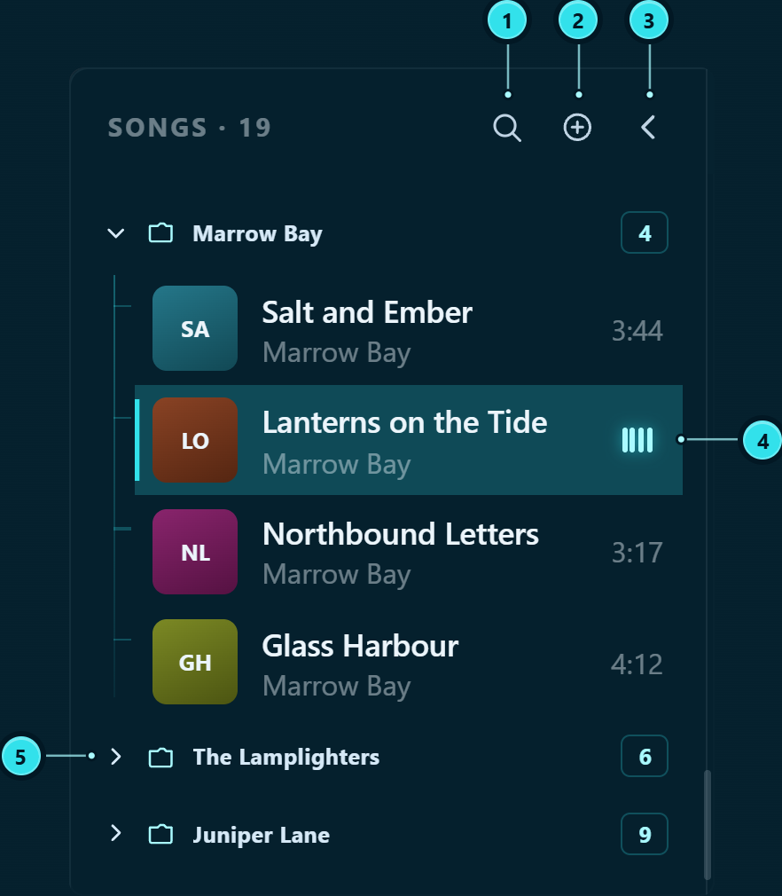

1. **Search songs** — Finds a song in the list by its title or its file's name.
2. **Add songs** — Add files or a folder, group the list by folder, or clear it.
3. **Collapse playlist** — Folds the list away to give the stage the room. The Playlist button at the start of the stage's row brings it back.
4. **The song on the stage** — It wears moving bars while it is sung. Click a song to pick it and double-click it to sing; point at a row to move it up or down or take it out of the list.
5. **A folder** — With the list grouped by folder, press a folder to fold its songs away or open them again. The number is how many songs it holds.

### Mix settings, on the player bar at the foot of the window

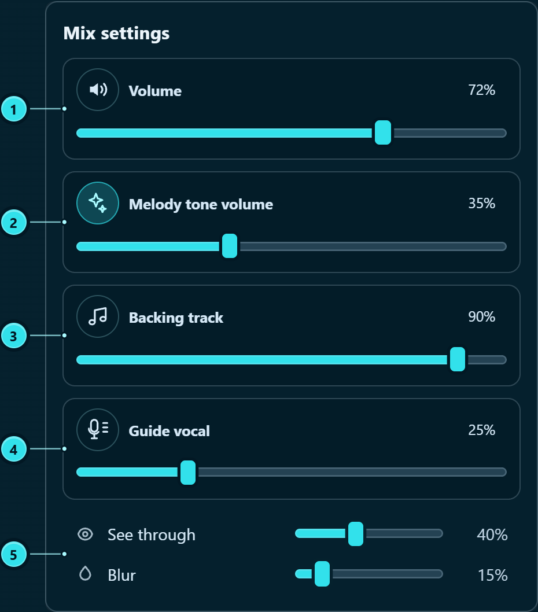

1. **Volume** — Your computer's volume, the same fader every tab's bar has. Its icon mutes the sound.
2. **Melody tone volume** — A tone that plays the song's notes, to sing along with. Its button turns it on or off.
3. **Backing track** — The music: the song itself, or its backing track once the Karaoke Maker has separated the voice from it.
4. **Guide vocal** — The singer's own voice, laid under the backing when the song has been separated. Down to zero for the music alone.
5. **Scene** — With the scene behind the words, how much of it shows through and how blurred it is. The Karaoke keeps its own, apart from the graph's.

### Microphone settings

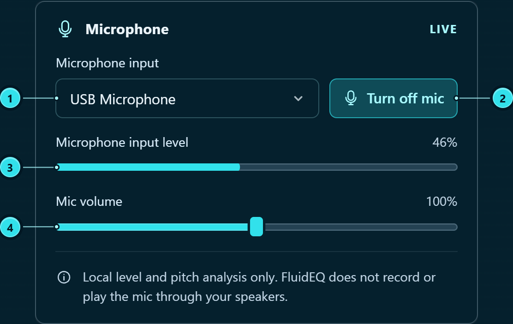

1. **Microphone input** — The microphone you sing into.
2. **Turn on mic** — Starts or stops listening. Whether it is on shows at the panel's top right.
3. **Microphone input level** — How loud the microphone hears you right now. Sing and watch it move.
4. **Mic volume** — Raises a microphone too quiet for your pitch to be heard, or lowers one that is too loud.

### The summary at the end of a song

1. **Summary** — Your score out of 10,000, its word, and how it stands against your best on this song.
2. **In tune · On time · Notes** — How much of the time you sang inside the notes, how many notes you came in on time, and how many you hit, with every verdict counted under them.
3. **What was hardest** — The line that gave you the most trouble and why, with one thing to try next time under it.
4. **Practise that passage** — Takes you back to just before that line to sing it again.
5. **Sing it again** — The whole song again, from the start.
6. **Song map** — Every line with its rating and how many points it moved since your best. Press a line to practise it.
7. **Your last attempts** — Your last tries at this song, this one and your best among them.

### Try it

1. Open Karaoke and press + beside Songs to add files or a whole folder: each song with its lyric file. Double-click a song to sing it.
2. Use the row at the top of the stage: Pitch and Chords turn the pitch strip and the chord chips on and off, each on its own; Scene, Art, Video or None chooses what stands behind the words. With Scene on, the scene picker appears beside it.
3. Turn on the microphone in the pitch strip's corner and sing. Each note is a box and your voice is a line through it: green in tune, yellow close, red off. Every note gets its verdict as it ends.
4. Under the strip, each line of the song is a row of cells with its score. Press a line to sing it again from just before it. When the song ends, its summary shows your score out of 10,000, what was hardest, a tip and every line against your best; See results opens it again.
5. Open Mix settings on the player bar for the volume, the melody tone, the backing track and, once the Maker has separated the song, the Guide vocal: the singer's own voice under the music, as loud as you want it.
6. Full screen gives the window to the stage. The row and the player bar step away after a few still seconds: move the pointer to the top edge for the header or to the bottom edge for the bar, or pin them with the buttons beside full screen.

> **Good to know:** A lyric file with only the words has no notes, so there is nothing on the strip to sing to or score; UltraStar files carry them, and the Karaoke Maker can add them. Chords come from the song's own files when it has them, a chord sheet beside the song or chords in its lyric file, and are worked out from the music otherwise. The microphone is analysed on this computer for level and pitch; FluidEQ never records it or plays it through your speakers.

## Create in Karaoke Maker

The Karaoke Maker turns a song into a karaoke you can sing: its words, when each one is sung, and the notes of the melody. It opens on the song on the stage, in one editor: the tools along the top, the song's sound with the words and notes under it, and a live preview of how the stage will show them.

### The editor: the song's sound, its words and its notes

1. **The grid** — The song's sound across the top, its words in three lanes under it, and its notes as boxes on the pitch grid, as the stage draws them. Drag with the middle mouse button to move through it in time and pitch.
2. **Pitch range** — Where the grid stands in pitch, against the whole range. Drag its ends to zoom, its middle to scroll; double-click it to fit the notes.
3. **Song position** — The whole song, with the part shown in the grid framed. Drag the frame to move, its edges to zoom.
4. **Follow lyrics** — Keeps the playhead in view as the song plays, turning the page when it reaches the edge.
5. **Live preview** — The words as the stage will show them, as the song plays. Its A slider sizes the words; hide it for more room.
6. **Lyric timing work status** — How many words you have adjusted by hand, and how many are still as they were detected or imported, with the song's notes, words and checks beside them.

### The tools along the top of the Maker

1. **Import karaoke** — Opens a karaoke file or a saved project, and keeps the audio already loaded.
2. **Lyrics** — The words and their timing, in one window.
3. **Lyrics timing** — Moves the words and notes together, for a song that runs early or late from the first second.
4. **Lyrics language** — Which language the words are in, and a second one beside it so the song can be sung in either.
5. **Record line entries** — Play the song and press a key as each line starts and ends. The timing comes from your presses.
6. **Select notes** — Draw a box around notes to move or delete them as one.
7. **Paint notes** — Draw the melody straight onto the pitch grid.
8. **Repair tools** — Separates the voice from the music and listens again for the words or the melody, with the AI models they need.
9. **Export** — Writes the finished karaoke out as a FluidEQ project, UltraStar TXT, LRC or enhanced LRC.
10. **Use in player** — Hands the finished karaoke to the stage and closes the Maker.

### The words, and when each one is sung

1. **Reference lyrics** — The whole song as text, one line per row. Paste it or load a file; FluidEQ finds the timing from it.
2. **Word timing** — Every word, in order, with how many are timed so far. Press one to work on it.
3. **Selected word** — Where the chosen word starts and how long it lasts. Moving its edge gives or takes time from the word beside it; the line keeps its length.

### Repair tools, and the AI models they need

1. **Separate voice from music** — Splits the recording into voice and music. The karaoke can then play without the singer, the Guide vocal fader can bring the voice back under it, and detection hears the words more clearly.
2. **Load vocal-only track** — Use a vocal-only file you already have, instead of separating one here.
3. **Re-detect lyric timing** — Listens to the separated voice again and re-times the words you already have. It waits until the voice is separated.
4. **Re-detect melody notes** — Listens to the separated voice again for the melody and rewrites the notes under the words. It waits until the voice is separated.
5. **AI model memory** — What each model needs and whether it is on this computer. They are downloaded the first time you use one.
6. **When it is idle** — Whether a model stays in memory between uses, and for how long. Releasing it frees memory; keeping it makes the next run start at once.

### Try it

1. On the Karaoke stage, press Open in Maker. Press Lyrics and paste the song's words or load a lyric file, one line per row, with every repeat written out.
2. Press Detect timing and melody to let FluidEQ listen for when each word is sung and which notes carry it, or Accept and record timing to tap each line in yourself as the song plays. The first time, the AI models it needs are downloaded.
3. Check the result in the grid: the words sit in lanes above the notes, and the notes are drawn as the stage draws them. Drag a word or a note to move it, or its edge to change its length. Select notes draws a box round several; Paint notes draws new ones.
4. Move through the song with the overview under the grid, or drag with the middle mouse button anywhere on the grid to move in time and pitch at once. The Pitch range against the grid's left edge zooms and scrolls the notes. Follow lyrics keeps the playhead in view, turning the page as it reaches the edge.
5. Press Use in player to sing it on the stage. Export saves it as a FluidEQ project, UltraStar TXT, LRC or enhanced LRC; a song from your Library can also be saved back to it with Save to Library.

> **Good to know:** Detection is a starting point: play short passages and correct the words and notes against the recording. Separating the voice from the music first lets detection hear the words more clearly, and gives the player its Guide vocal fader. Models need a connection and disk space the first time; use audio and lyrics you are allowed to work with.

## Share audio between computers

Share Audio links computers on the same private network into one group, and each one plays the others’ sound: whichever one you sit at, you hear the rest. Each computer sends its own sound straight to the others, untouched, and never sends back what it receives, so there is no echo; the computer you listen on applies its own EQ, curves and DSP. This is separate from mirroring to a second device on one computer.

1. **Your mix** — This PC’s volume, and a level for each computer you hear.
2. **Output** — Where this computer plays the group.
3. **Add computer** — Copy this computer’s code, or paste another’s and press Link.
4. **Share** — Share sends this computer’s sound to the whole group; Fluid beside it adds a small cushion for a connection that stalls.
5. **What it plays** — That computer’s song and its sound as it arrives, with the delay each way.
6. **Receive and Send** — Receive plays that computer here; Send plays this one there. Its ••• menu pauses, resumes, reconnects or unlinks it.

### Try it

1. On one computer, open Share Audio, press Add computer and then Copy code. Start at a low volume.
2. On the other computer, press Add computer, paste the code under The other computer’s code and press Link. Both computers play each other right away. Link more computers the same way: each one joins the whole group, and computers that join through another one appear with Receive off until you turn it on.
3. In The whole group, each computer has two switches, Receive and Send; Share turns this computer’s sound off for all of them. Your mix sets This PC’s volume and a level for each computer.
4. Pause, Resume and Unlink are in each computer’s menu. A computer that is away stays listed as Offline, and the group finds itself again after a restart, sleep, a network drop or an engine switch.
5. Turn Fluid on beside Share for music over a connection that stalls. It adds a small playback cushion; switch it off when lower delay matters more.
6. For a saved computer that stays Offline, open its ••• menu and choose Reconnect. It tries the saved code again without forgetting the link; if the other computer’s address changed, copy and paste its current code.

> **Good to know:** Keep the connection code private: it authorizes linking. Under the FluidEQ Engine this computer keeps its DSP on while it shares, and the computer playing its sound applies its own. Playing and sending at once needs Windows on that computer; elsewhere a link runs one way.

## When something sounds wrong

Start with the source and output, then isolate the layer. A graph, a saved preset or an enabled switch alone cannot prove that sound reached the intended device. The Help menu also leads to audio troubleshooting, problem reporting and the Forum.

1. **The engine’s notice** — Says which output the engine is not reaching and why, at the bottom right of the window, once sound is heard there.
2. **Use Equalizer APO…** — Switches to Equalizer APO instead, through the engine dialog.
3. **Restart Windows audio** — Restarts Windows audio, which usually brings the engine back. Windows asks for permission.

### Try it

1. No sound: confirm playback is running, the expected output is selected, volume is up, and the device is connected. Check whether One player at a time paused another source.
2. No EQ change: confirm the power key at the top of the left rail is on and the output shows no OFF badge; press Enable if it does. If the engine’s notice says it is not running, press Restart Windows audio.
3. Everything looks right and the EQ still does nothing: Windows may be playing the music past the engine. The notice says so and offers one press to move the engine somewhere Windows will use; it costs a permission prompt and a second of silence.
4. Distortion or excessive bass: leave Auto normalize on, reduce boosts and bypass layers one at a time. If it persists, use Report a problem and review the report before sending.

> **Good to know:** F1 opens this guide. Esc closes an enlarged capture, then the guide. If the interface is too large, Ctrl + 0 resets zoom. Processes in the actions menu shows what each part of FluidEQ is doing.

## Ask in the Forum

The Forum brings FluidEQ’s GitHub Discussions into the app: announcements, ideas, questions and tunings people are proud of. Anyone can read; posting uses your GitHub account, not a FluidEQ one.

1. **Boards** — Every board with its count. New for you gathers what came in since you last looked, and Issues lists the problems reported on GitHub.
2. **Text size** — Makes the Forum’s text, and this guide’s, larger or smaller.
3. **Your GitHub account** — Who you post as. Sign out leaves the Forum readable and stops posting.
4. **New topic** — New topic starts a discussion; Mark all as read clears the counts, and the arrow fetches what is new.
5. **Search the forum** — Searches the topics and replies of every board.
6. **Topics** — Latest activity first, each with its board, its state, its replies and its votes. Open one to read it and reply.

### Try it

1. Open Help → Forum and pick a board: Announcements, General, Ideas, Polls, Q&A, Show and tell, Tips & tricks or Support FluidEQ. New for you gathers what came in since you last looked, and Issues lists the problems reported on GitHub.
2. Search the forum, or open a topic to read the replies.
3. Press Sign in with GitHub, finish in your browser, then post a New topic or a reply.

> **Good to know:** Everything posted is public on GitHub under your GitHub name. On Q&A, mark the answer that worked so the next person finds it. Each board’s yellow count shows topics with activity you have not seen; Issues counts open issues. Half-written topics and replies are kept when you leave. Press a post’s picture to enlarge it inside FluidEQ.
